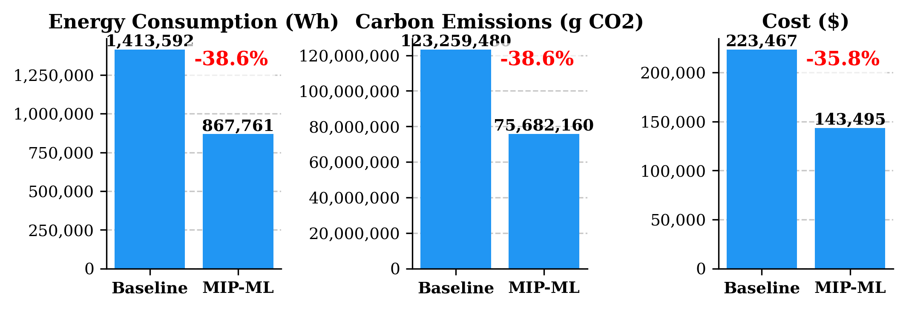

::: {.ppr-meta}
Department of Computer Science, Iowa State University · Department of Electrical and Computer Engineering, Florida State University · *57th North American Power Symposium (NAPS) 2025*, Storrs, CT
:::

```{=html}
<div class="ppr-actions">
  <a href="https://doi.org/10.1109/NAPS66256.2025.11272265" target="_blank" rel="noopener"><i class="bi bi-file-earmark-pdf-fill"></i> Paper (IEEE Xplore)</a>
  <a class="a-slides" href="/misc/info/presentations/Multi_objective_NAPS_presentation.pdf" target="_blank" rel="noopener"><i class="bi bi-easel2-fill"></i> Slides</a>
  <a class="a-cite" href="#cite"><i class="bi bi-quote"></i> Cite</a>
</div>
```

::: {.column-margin}
Published in IEEE Xplore as *"A Multi-Objective Framework for Energy, Cost, and Carbon Trade-offs in Smart Energy Systems."*
:::

::: {.tldr}
[TL;DR]{.k}

A household's electricity bill and carbon footprint both depend on **when** appliances run, not only on how much energy they use. We forecast household demand with an ensemble of Random Forest and XGBoost, measure how uncertain each forecast is, and feed both into a **mixed-integer program (MIP)** solved with Gurobi. The program schedules each appliance ON or OFF to minimize a weighted mix of cost, carbon, and energy, while keeping run times, energy needs, and user comfort within limits. On nearly four years of real household data, the schedule shifts load into cheaper, cleaner hours.

```{=html}
<div class="stats">
  <div><b>−35.8%</b><span>operational cost ($223,467 → $143,495)</span></div>
  <div><b>−38.6%</b><span>carbon emissions (123.3 t → 75.7 t CO₂)</span></div>
  <div><b>−25.8%</b><span>peak demand, from smarter load shifting</span></div>
</div>
```
:::

## Why household scheduling matters

In 2022, residential energy use accounted for about **30% of global energy consumption** and **20% of global CO₂ emissions**, largely because of inefficient scheduling.[^iea] As grids add renewables, both the price of electricity and its carbon intensity change hour by hour. Under the profiles used in this paper, a dishwasher cycle at 7 pm costs **twice as much** and emits **almost three times as much CO₂** as the same cycle at 1 pm, when solar power is abundant.

[^iea]: International Energy Agency, *The Future of Cooling*, 2018.

**Home Energy Management Systems (HEMS)** try to exploit this by scheduling appliances and storage around dynamic prices. Earlier studies report bill reductions of nearly 20% with renewable integration[^ahmad] and annual savings of 3–6% from adapting to user behavior and climate.[^moser]

[^ahmad]: A. Ahmad et al., "An optimized home energy management system with integrated renewable energy and storage resources," *Energies*, 2017.

[^moser]: A. Moser et al., "A MILP-based modular energy management system for urban multi-energy systems," *Applied Energy*, 2020.

### The gap: forecasting and scheduling live apart

Existing work tends to fall into one of two camps:

- **Machine learning** forecasts consumption well (XGBoost, CNN–LSTM hybrids) but **can't decide** when to run anything.
- **Optimization** (MILP/MIP) schedules for minimum cost or carbon but usually **ignores the uncertainty** in the demand it is scheduling around.

Few studies combine the two. This paper does: ML predictions and their uncertainty become **constraints** inside the optimizer.

```{=html}
<table class="hp">
  <thead><tr><th>Ref.</th><th>Objective</th><th>Technique</th><th>Result</th><th>Test system</th></tr></thead>
  <tbody>
    <tr><td>[2]</td><td>Model predictive control with storage and renewables</td><td>MILP</td><td>Cost savings via predictive control</td><td>Algarve residential case</td></tr>
    <tr><td>[7]</td><td>Urban energy forecasting</td><td>XGBoost + SHAP</td><td>Forecasts for municipal planning</td><td>Philadelphia urban areas</td></tr>
    <tr><td>[9]</td><td>Battery inverter cost optimization</td><td>Iterative LP</td><td>Higher efficiency, lower cost</td><td>Distributed energy systems</td></tr>
    <tr><td>[10]</td><td>Solar radiation prediction</td><td>CNN–LSTM–MLP hybrid</td><td>Better accuracy than traditional models</td><td>Solar farms (Queensland)</td></tr>
    <tr><td>[12]</td><td>Demand-side management with thermostat control</td><td>MILP with ML</td><td>Higher demand flexibility</td><td>Grid-interactive homes</td></tr>
    <tr><td><b>Ours</b></td><td><b>Multi-objective smart energy management</b></td><td><b>Ensemble ML + MIP</b></td><td><b>35.8% cost and 38.6% CO₂ reduction</b></td><td><b>Real household consumption data</b></td></tr>
  </tbody>
</table>
```

### What this paper contributes

- **A hybrid scheduler** that merges ensemble ML demand prediction with robust MIP, giving uncertainty-aware appliance schedules that move load to lower-cost, lower-carbon periods.
- **A robust MIP constraint system** for power balance, user comfort, and sustainability goals.
- **A multi-objective function** that balances cost, carbon, and energy, with a slack penalty for unmet demand, solved in Gurobi.
- **Validation on real household data**, showing reductions in cost, emissions, and energy use.

## Problem formulation

### A weighted multi-objective

We want a schedule that is cheap, clean, and efficient, and those goals can pull in different directions. We combine them with a **weighted sum**:

$$
\min \Big[\; \underbrace{w_1 \cdot C_t}_{\text{Cost}} \;+\; \underbrace{w_2 \cdot CI_t}_{\text{Carbon}} \;+\; \underbrace{w_3 \cdot E}_{\text{Energy}} \;+\; \underbrace{w_4 \cdot \text{slack}_t}_{\text{Feasibility}} \;\Big]
$$ {#eq-objective}

```{=html}
<div class="wbar" aria-label="Default objective weights">
  <div class="w-cost">Cost · 0.4</div>
  <div class="w-co2">Carbon · 0.3</div>
  <div class="w-en">Energy · 0.3</div>
  <div class="w-sl" title="Slack · 0.001"></div>
</div>
<div class="wbar-legend">Default weights. Cost gets the largest share because it is the user's main concern. The slack weight w₄ = 0.001 (thin grey sliver) only keeps the problem feasible. If different weights are chosen they are re-normalized so that Σwᵢ ≈ 1.</div>
```

::: {.column-margin}
**Tunable by design.** A utility running a carbon program might raise $w_2$, while a cost-sensitive household might raise $w_1$. The framework doesn't change, only the weights do.
:::

Each term is built from the binary schedule $x_{t,a}$ (appliance $a$ ON or OFF at time $t$) and the appliance power $\text{power}_{t,a}$ in Wh.

**Cost** under dynamic (time-of-use or real-time) prices $P_t$, plus a penalty for unmet demand:

$$
C_t = \sum_{t \in T} \sum_{a \in A} \text{power}_{t,a} \cdot x_{t,a} \cdot P_t \;+\; \text{slack}_t \cdot P_{\text{penalty}}
$$ {#eq-cost}

**Carbon**, weighting consumption by the grid's carbon intensity at that hour:

$$
CI_t = \sum_{t,a} \text{power}_{t,a} \cdot x_{t,a} \cdot CI_t
$$ {#eq-carbon}

**Energy**, the total consumed. Minimizing it discourages waste, while @eq-energy-req below prevents drastic cuts that would hurt comfort:

$$
E = \sum_{t,a} \text{power}_{t,a} \cdot x_{t,a}
$$ {#eq-energy}

**Slack penalty**, which discourages unmet demand:

$$
\text{slack}_t = \sum_{t} \kappa \times s_t
$$ {#eq-slack}

::: {.column-margin}
**Normalization.** Cost is in dollars, carbon in grams, and energy in watt-hours, so adding them directly would let the largest number win. Each term is divided by a constant, the maximum power demand times the highest price, carbon intensity, or energy value, so the weights compare like with like.
:::

### Decision variables

- $x_{t,a} \in \{0, 1\}$: appliance $a$ is ON ($1$) or OFF ($0$) at time $t$.
- $\text{slack}_t \ge 0$: unmet demand at time $t$, used when demand exceeds supply.

### Constraints

**Power balance.** Scheduled appliance power can't exceed the household's available active power:

$$
\sum_a \text{power}_{t,a} \cdot x_{t,a} \;\le\; P_{(\text{active},t)} + \text{slack}_t, \qquad \forall t
$$ {#eq-balance}

**Minimum runtime.** Once switched on, an appliance runs for at least $k = 3$ consecutive 5-minute intervals (15 minutes), which prevents rapid cycling:

$$
\sum_{i=0}^{k-1} x_{t+i,a} \;\ge\; k \times \big(x_{t,a} - x_{t-1,a}\big), \qquad \forall t, a
$$ {#eq-runtime}

::: {.column-margin}
**How @eq-runtime works.** The term $x_{t,a} - x_{t-1,a}$ equals 1 only at the moment an appliance turns ON. At that moment the next $k$ slots must all be ON. At any other time the right-hand side is 0 or negative, so the constraint is inactive.
:::

**Energy requirement.** Each appliance still gets 90–110% of its baseline energy $E_a = \sum_{t \in T} \text{power}_{t,a}$. Load is **shifted**, not removed:

$$
0.9\,E_a \;\le\; \sum_{t \in T} \text{power}_{t,a} \cdot x_{t,a} \;\le\; 1.1\,E_a, \qquad \forall a \in A
$$ {#eq-energy-req}

**Switching frequency.** The same structure, applied with each appliance's minimum operating time, limits how often appliances switch:

$$
\sum_{i=0}^{\text{min\_runtime}-1} x_{t+i,a} \;\ge\; \text{min\_runtime} \cdot \big(x_{t,a} - x_{t-1,a}\big), \qquad \forall t, a
$$ {#eq-switch}

### The ML trust region

This is the link between prediction and optimization. The scheduled load has to stay within an uncertainty band around the ML-predicted load $\hat{y}_t$:

$$
\Big|\, \sum_{a \in A} \text{power}_{t,a} \cdot x_{t,a} \;-\; \hat{y}_t \,\Big| \;\le\; \epsilon_t
$$ {#eq-trust}

Here $\epsilon_t$ is an uncertainty bound from quantile regression or prediction intervals. When the forecast is confident, the band is narrow and the optimizer follows it closely. When demand is volatile, the band widens and the optimizer has more freedom.

::: {.column-margin}
**Why a trust region?** Without it the optimizer would treat the forecast as exact and might build a schedule around a demand that never happens. The trust region lets the optimizer use the forecast **in proportion to how much it can be trusted**.
:::

## Data and features

### The household dataset

We use the UCI *Individual Household Electric Power Consumption* dataset:[^uci] one household, sampled **every minute for nearly four years**. It records global active and reactive power, current intensity, and three sub-meters: kitchen, laundry room, and electric water heater plus air conditioner.

[^uci]: G. Hebrail and A. Berard, "Individual Household Electric Power Consumption," UCI Machine Learning Repository, 2006. [doi:10.24432/C58K54](https://doi.org/10.24432/C58K54)

$$
D = \{P_{\text{active},t},\; P_{\text{reactive},t},\; I,\; M_i\}
$$ {#eq-data}

Active power is converted from kW to watt-hours per minute, and everything the three sub-meters don't cover is grouped as "other":

$$
P_{\text{Wh}}(t) = P_{\text{active}}(t) \times \frac{1000}{60}
$$ {#eq-wh}

$$
P_{\text{other}}(t) = P_{\text{Wh}}(t) - \sum_{i=1}^{3} P_{M_i}(t)
$$ {#eq-other}

### Temporal features

Demand follows the clock and the calendar, so we encode time explicitly, using cyclical encoding for periodic features:

$$
F_t =
\begin{cases}
h_t \in [0, 23] \\
\text{weekday} \in [0, 6] \\
m_t \in [1, 12] \\
\text{is\_weekend} = \begin{cases} 1 & \text{if weekday} \ge 5 \\ 0 & \text{otherwise} \end{cases} \\
d_t \in [1, 366] \\
\text{week\_of\_year} \in [1, 53] \\
sa_t = \begin{cases} 0 & m_t \in \{12, 1, 2\} \\ 1 & m_t \in \{3, 4, 5\} \\ 2 & m_t \in \{6, 7, 8\} \\ 3 & \text{otherwise} \end{cases}
\end{cases}
$$ {#eq-features}

::: {.column-margin}
**Cyclical encoding.** Hour 23 and hour 0 are one minute apart but 23 units apart as raw numbers. Mapping a periodic value onto a circle with $\sin(2\pi h/24)$ and $\cos(2\pi h/24)$ puts them next to each other.
:::

### Trend and appliance-share features

Lagged and rolling statistics capture recent behavior:

$$
\begin{aligned}
\text{prev\_consumption} &= P_{\text{Wh}}(t - 24) \\
\text{rolling\_mean}_{24} &= \frac{1}{24} \sum_{i=t-23}^{t} P_{\text{Wh}}(i) \\
\text{rolling\_deviation}_{24} &= \sqrt{\frac{1}{24} \sum_{i=t-23}^{t} \big(P_{\text{Wh}}(i) - \mu\big)^2}
\end{aligned}
$$ {#eq-rolling}

For each sub-meter we also track its **share** of total consumption and its rolling mean:

$$
\text{rolling}_i = \frac{M_i}{P_{\text{Wh}}}, \qquad
\text{rolling\_mean}_i = \frac{1}{24} \sum_{j=t-23}^{t} M_i(j)
$$ {#eq-share}

## Carbon-intensity and price profiles

The schedule only pays off because carbon intensity and price change through the day. We build hourly profiles based on typical grid behavior and real-world time-of-use pricing:[^doe]

[^doe]: U.S. DOE, "Demand Response and Time-Variable Pricing Programs"; U.S. EIA, *Electric Power Monthly*.

$$
CI_t =
\begin{cases}
50 & h_t \in \{9,\dots,15\} \quad \text{(solar hours)} \\
140 & h_t \in \{17,\dots,21\} \quad \text{(peak hours)} \\
80 & h_t \in \{0,\dots,5,\, 22,\, 23\} \quad \text{(night hours)} \\
100 & \text{otherwise}
\end{cases}
\quad \text{gCO}_2/\text{kWh}
$$ {#eq-ci}

$$
C_t =
\begin{cases}
0.30 & h_t \in \{17, 18, 19, 20\} \quad \text{(peak)} \\
0.08 & h_t \in \{0,\dots,5,\, 23\} \quad \text{(off-peak)} \\
0.15 & \text{otherwise}
\end{cases}
\quad \$/\text{kWh}
$$ {#eq-price}

The same two profiles as a 24-hour strip:

```{=html}
<div class="hours" id="hours-strip" aria-label="Hourly carbon intensity and price profiles"></div>
<div class="hours-legend">
  <span style="--sw:#2e7d32">Clean / cheap</span>
  <span style="--sw:#8a9a3a">Moderate</span>
  <span style="--sw:#d08a1f">Higher</span>
  <span style="--sw:#c0392b">Peak</span>
</div>
<script>
(function () {
  const el = document.getElementById("hours-strip");
  const ci = h => (h >= 9 && h <= 15) ? 50 : (h >= 17 && h <= 21) ? 140 : (h <= 5 || h >= 22) ? 80 : 100;
  const pr = h => (h >= 17 && h <= 20) ? 0.30 : (h <= 5 || h === 23) ? 0.08 : 0.15;
  const ciCol = v => ({50:"#2e7d32", 80:"#8a9a3a", 100:"#d08a1f", 140:"#c0392b"})[v];
  const prCol = v => ({0.08:"#2e7d32", 0.15:"#d08a1f", 0.30:"#c0392b"})[v];
  let html = '<div></div>';
  for (let h = 0; h < 24; h++) html += '<div class="h">' + h + '</div>';
  html += '<div class="lab">gCO₂/kWh</div>';
  for (let h = 0; h < 24; h++) { const v = ci(h); html += '<div class="c" style="background:' + ciCol(v) + '" title="' + h + ':00 · ' + v + ' gCO₂/kWh">' + v + '</div>'; }
  html += '<div class="lab">$/kWh</div>';
  for (let h = 0; h < 24; h++) { const v = pr(h); html += '<div class="c" style="background:' + prCol(v) + '" title="' + h + ':00 · $' + v.toFixed(2) + '/kWh">' + v.toFixed(2).replace(/^0/, "") + '</div>'; }
  el.innerHTML = html;
})();
</script>
```

::: {.column-margin}
**Reading the strip.** Midday (9:00–15:00) is the cleanest grid at a normal price. Late night (0:00–5:00) is the cheapest. Evening (17:00–20:00) is both the dirtiest **and** the most expensive. The optimizer's job is to move flexible appliances out of that evening window.
:::

## The hybrid ML + MIP model

### Ensemble demand prediction

Two tree ensembles do different jobs. **Random Forest** captures non-linear appliance-usage patterns and gives stable trend tracking. **XGBoost** boosts on residual errors to refine the prediction. They are blended with weights chosen by cross-validation:

$$
\hat{y}_{\text{ML}}(x) = 0.6 \cdot \hat{y}_{\text{RF}}(x) + 0.4 \cdot \hat{y}_{\text{XGB}}(x)
$$ {#eq-ensemble}

### Folding the prediction into the optimizer

The scheduled appliance load is tied to the prediction, with room for its uncertainty:

$$
\sum_{a \in A} P_{t,a} \cdot x_{t,a} = \hat{y}_{\text{ML}}(t) \pm \sigma_{\text{uncertainty}}(t)
$$ {#eq-hybrid}

### Uncertainty integration

The ensemble's uncertainty combines the two models' variances, weighted the same way as their predictions,

$$
\sigma_{\text{ensemble}}(t) = \sqrt{w_{\text{RF}}^2\, \sigma_{\text{RF}}^2 + w_{\text{XGB}}^2\, \sigma_{\text{XGB}}^2}
$$ {#eq-sigma}

around the weighted mean prediction

$$
\mu(t) = w_{\text{RF}} \cdot \hat{y}_{\text{RF}}(t) + w_{\text{XGB}} \cdot \hat{y}_{\text{XGB}}(t).
$$ {#eq-mu}

This gives a demand band $\big[\mu(t) - \sigma_{\text{ensemble}}(t),\; \mu(t) + \sigma_{\text{ensemble}}(t)\big]$. When $\sigma_{\text{ensemble}}(t) > \tau$, the dynamic constraints are **relaxed**, so the optimizer isn't held to a forecast it shouldn't trust. The trust-region bounds $\epsilon_t$ come from quantile regression with 90% confidence intervals.

{#fig-workflow width=70%}

### Algorithm

```{=html}
<div class="algo">
  <div class="t">Algorithm 1 · Hybrid ML-optimization framework</div>
  <ol>
    <li><span class="kw">Data preparation and feature engineering</span></li>
    <li class="in1">Collect P<sub>Wh</sub>(t) and sub-metering data {M₁, …, Mₙ}</li>
    <li class="in1">Residual consumption OEₜ = P<sub>Wh</sub>(t) − Σᵢ Mᵢ(t)</li>
    <li class="in1">Extract temporal features (hour of day, day-type flags, …)</li>
    <li class="in1">Split into training (70%) and validation (30%)</li>
    <li><span class="kw">Ensemble learning</span></li>
    <li class="in1">Train Random Forest (feature-importance weighting) and XGBoost (early stopping)</li>
    <li class="in1">ŷₜ = α · RF(Fₜ) + (1 − α) · XGB(Fₜ)</li>
    <li class="in1">Quantify uncertainty with quantile regression forests</li>
    <li><span class="kw">Constrained optimization</span></li>
    <li class="in1">min Σ w₁Eₜ + w₂Cₜ + w₃CIₜ  s.t. Σₐ Pₜ,ₐxₜ,ₐ ≤ Pₜᵐᵃˣ, |Σₐ Pₜ,ₐxₜ,ₐ − ŷₜ| ≤ εₜ, xₜ,ₐ ∈ {0,1}, Σ xτ,ₐ ≥ Lₐᵐⁱⁿ</li>
    <li class="in1">Calibrate weights wᵢ by sensitivity analysis in Gurobi</li>
    <li><span class="kw">Solution and validation</span></li>
    <li class="in1">Branch-and-cut solve with ML warm starts</li>
    <li class="in1">Check energy balance |ΣSₜ − Σŷₜ| ≤ δ</li>
    <li class="in1">Compute ΔC, ΔCI, and peak reduction maxₜ Sₜ / maxₜ Pₜ</li>
    <li><span class="kw">return</span> optimal schedule S*, metrics M</li>
  </ol>
</div>
```

## Implementation

```{=html}
<table class="hp">
  <thead><tr><th>Component</th><th>Setting</th></tr></thead>
  <tbody>
    <tr><td>Random Forest</td><td>200 trees, max depth 20</td></tr>
    <tr><td>XGBoost</td><td>200 estimators, max depth 8, fit on residuals</td></tr>
    <tr><td>Ensemble</td><td>60% RF + 40% XGBoost (cross-validated); uncertainty from RF tree variance and XGBoost prediction intervals</td></tr>
    <tr><td>Objective weights</td><td>w₁ = 0.4 (cost), w₂ = 0.3 (carbon), w₃ = 0.3 (energy), w₄ = 0.001 (feasibility)</td></tr>
    <tr><td>Slack penalty</td><td>κ = 1000</td></tr>
    <tr><td>Appliance limits</td><td>Minimum runtime 15 min; energy within ±10% of baseline</td></tr>
    <tr><td>Gurobi, phase 1</td><td>5% MIP gap, 300 s time limit, presolve and cutting planes</td></tr>
    <tr><td>Gurobi, phase 2</td><td>1% MIP gap, objective ranges adjusted from ML demand predictions</td></tr>
  </tbody>
</table>
```

### What the data looks like

{#fig-analysis width=95%}

The temporal features show clear structure. Hourly peaks reach roughly **10,600 W**, and weekly peaks range from **8,500 W to 10,500 W**. The sub-meters behave very differently. $M_1$ sits mostly at low power with a small peak around **37 W**. $M_2$ is concentrated near zero with a short tail. $M_3$ shows distinct peaks at **15 W and 17 W** on top of its base load. These different patterns are why per-appliance scheduling beats treating the house as one load.

## Results

### Two-phase optimization

**Phase 1, learning.** Both forecasters fit the data well: **R² = 0.9182** for Random Forest and **R² = 0.9055** for XGBoost.

**Phase 2, optimizing.** Gurobi worked on a model with **over 10 million rows**. Presolve cut the model size by nearly **90%** and found a solution with objective ≈ 30,187 at a **2.89% gap**. A second, ML-enhanced pass tightened the gap tolerance to 1% and adjusted objective ranges from the demand predictions. It reached an optimal solution with a **zero gap**.

::: {.column-margin}
**Why presolve matters.** A minute-level schedule over years of data gives binary variables for every appliance in every interval. Presolve removes redundant rows and fixes variables it can infer, so the remaining problem is small enough for branch-and-cut to finish.
:::

::: {#tbl-results}
```{=html}
<table class="ba">
  <thead><tr><th>Metric</th><th style="text-align:right">Baseline</th><th style="text-align:right">MIP-ML</th><th style="text-align:right">Change</th></tr></thead>
  <tbody>
    <tr><td>Energy consumption</td><td class="num">1,413,592 Wh</td><td class="num">867,761 Wh</td><td class="gain">−38.6%</td></tr>
    <tr><td>Carbon emissions</td><td class="num">123,259,480 g CO₂</td><td class="num">75,682,160 g CO₂</td><td class="gain">−38.6%</td></tr>
    <tr><td>Operational cost</td><td class="num">$223,467</td><td class="num">$143,495</td><td class="gain">−35.8%</td></tr>
    <tr><td>Daily peak demand</td><td class="num">124 W</td><td class="num">92 W</td><td class="gain">−25.8%</td></tr>
  </tbody>
</table>
```

Baseline schedule vs. the ML-enhanced MIP schedule. All constraints are satisfied in the optimized schedule.
:::

{#fig-results width=100%}

### Reading the results

::: {.insight}
[Key insight]{.k}

The biggest win is **when** energy is used, not only how much. Moving flexible loads out of the 17:00–21:00 window avoids the highest price ($0.30/kWh) and the dirtiest grid (140 gCO₂/kWh) at the same time, so cost and carbon fall together. The ±10% energy constraint guarantees appliances still get the energy they need. The schedule moves the load rather than cutting it.
:::

The **25.8% peak reduction** matters beyond the household. Lower and flatter peaks reduce grid stress, defer infrastructure upgrades, and are exactly what demand-response programs pay for.

## Conclusion and future work

A hybrid of ensemble machine learning and mixed-integer optimization can schedule household appliances around both price and carbon, while respecting runtime, energy, and comfort limits. On real household data it cut **peak demand by 25.8%**, **operational cost by 35.8%**, and **carbon emissions by 38.6%**. The Random Forest + XGBoost ensemble gives robust forecasts with measurable uncertainty, and the trust region keeps the optimizer honest about how far to rely on them.

**Next steps:** integrating live smart-meter data, and adding federated learning and deep temporal models to improve scalability and preserve privacy across many households.

## Cite this work {#cite}

> K. Kumar and G. Ravikumar, "A Multi-Objective Framework for Energy, Cost, and Carbon Trade-offs in Smart Energy Systems," *2025 57th North American Power Symposium (NAPS)*, Storrs, CT, USA, 2025, pp. 1–6, doi: [10.1109/NAPS66256.2025.11272265](https://doi.org/10.1109/NAPS66256.2025.11272265).

```bibtex
@inproceedings{kumar2025naps_carbon,
  author    = {Kumar, Kundan and Ravikumar, Gelli},
  title     = {A Multi-Objective Framework for Energy, Cost, and Carbon Trade-offs in Smart Energy Systems},
  booktitle = {2025 57th North American Power Symposium (NAPS)},
  year      = {2025},
  pages     = {1--6},
  address   = {Storrs, CT, USA},
  doi       = {10.1109/NAPS66256.2025.11272265}
}
```

## Acknowledgment

This research is funded in part by US NSF Grant #CNS 2105269, US DOE CESER Grant DE-CR000016, and Iowa Energy Center Grant #21-IEC-009.

## References

1. International Energy Agency, "The future of cooling: Opportunities for energy-efficient air conditioning," 2018. [iea.org](https://www.iea.org/reports/the-future-of-cooling)
2. A. Ahmad et al., "An optimized home energy management system with integrated renewable energy and storage resources," *Energies*, vol. 10, no. 4, 2017.
3. A. Moser et al., "A MILP-based modular energy management system for urban multi-energy systems: Performance and sensitivity analysis," *Applied Energy*, vol. 261, p. 114342, 2020.
4. I. Gomes, M. Ruano, and A. Ruano, "MILP-based model predictive control for home energy management systems: A real case study in Algarve, Portugal," *Energy and Buildings*, vol. 281, p. 112774, 2023.
5. D. Lauinger, P. Caliandro, J. Van herle, and D. Kuhn, "A linear programming approach to the optimization of residential energy systems," *Journal of Energy Storage*, vol. 7, pp. 24–37, 2016.
6. L. Fiorini and M. Aiello, "Automatic optimal multi-energy management of smart homes," *Energy Informatics*, vol. 5, no. 1, p. 68, 2022.
7. S. Shams Amiri, M. Mueller, and S. Hoque, "Investigating the application of a commercial and residential energy consumption prediction model for urban planning scenarios with machine learning and Shapley additive explanation methods," *Energy and Buildings*, vol. 287, p. 112965, 2023.
8. L. Di Persio and N. Fraccarolo, "Energy consumption forecasts by gradient boosting regression trees," *Mathematics*, vol. 11, no. 5, 2023.
9. F. Carreras and H. Kirchsteiger, "An iterative linear programming approach to optimize costs in distributed energy systems by considering nonlinear battery inverter efficiencies," *Electric Power Systems Research*, vol. 218, p. 109183, 2023.
10. S. Ghimire et al., "Deep learning CNN-LSTM-MLP hybrid fusion model for feature optimizations and daily solar radiation prediction," *Measurement*, vol. 202, p. 111759, 2022.
11. M. Galici, E. Ghiani, F. Pilo, and G. Pisano, "Dynamic programming for optimal energy management in nanogrids," *IEEE RTSI*, 2021, pp. 103–108.
12. A. Savasci, O. Ceylan, and S. Paudyal, "Optimal dead band control of occupant thermostats for grid-interactive homes," *SEST*, 2024, pp. 1–6.
13. M. Agabalaye-Rahvar et al., "Economic analysis of energy efficiency programs with energy storage systems on the optimal smart microgrid energy management," *ICTEM*, 2024, pp. 1–7.
14. U.S. Department of Energy, "Demand Response and Time-Variable Pricing Programs." [energy.gov](https://www.energy.gov/femp/demand-response-and-time-variable-pricing-programs)
15. G. Hebrail and A. Berard, "Individual Household Electric Power Consumption," UCI Machine Learning Repository, 2006. [doi:10.24432/C58K54](https://doi.org/10.24432/C58K54)
16. U.S. Energy Information Administration, "Electric Power Monthly." [eia.gov](https://www.eia.gov/electricity/monthly/index.php)
