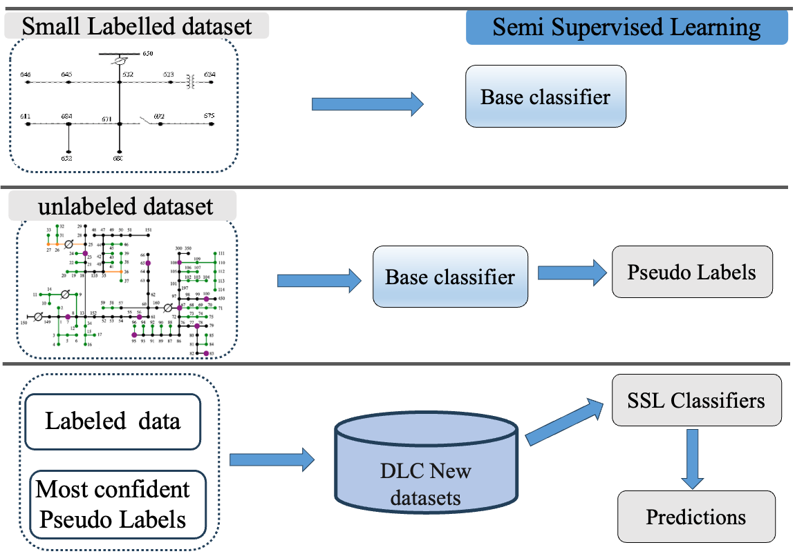
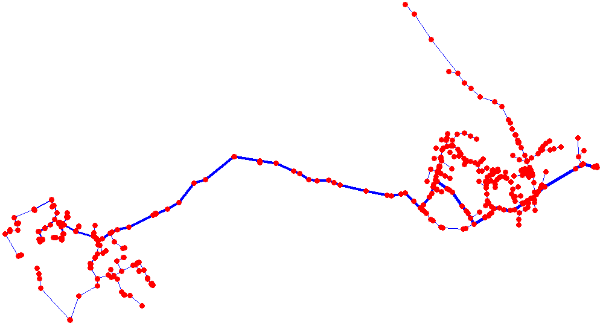
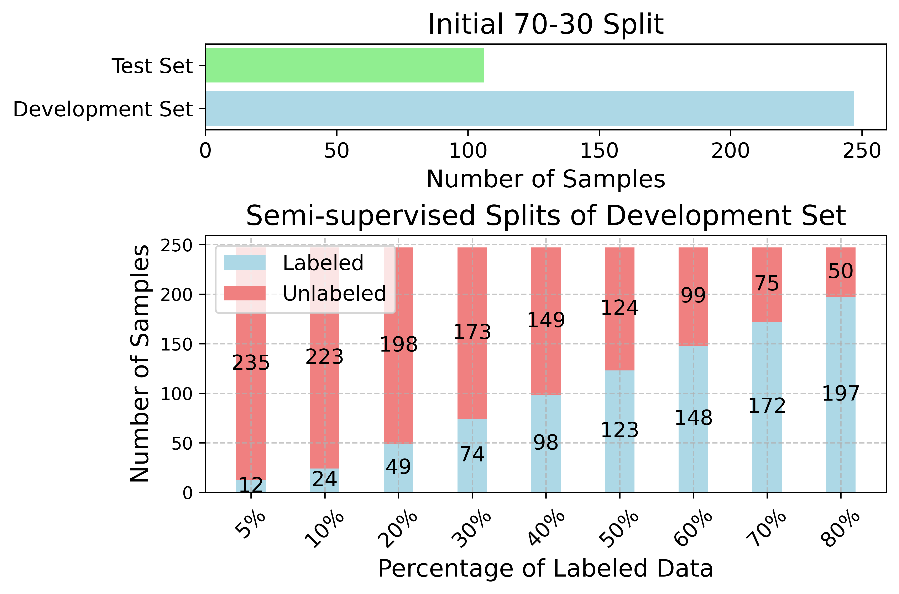
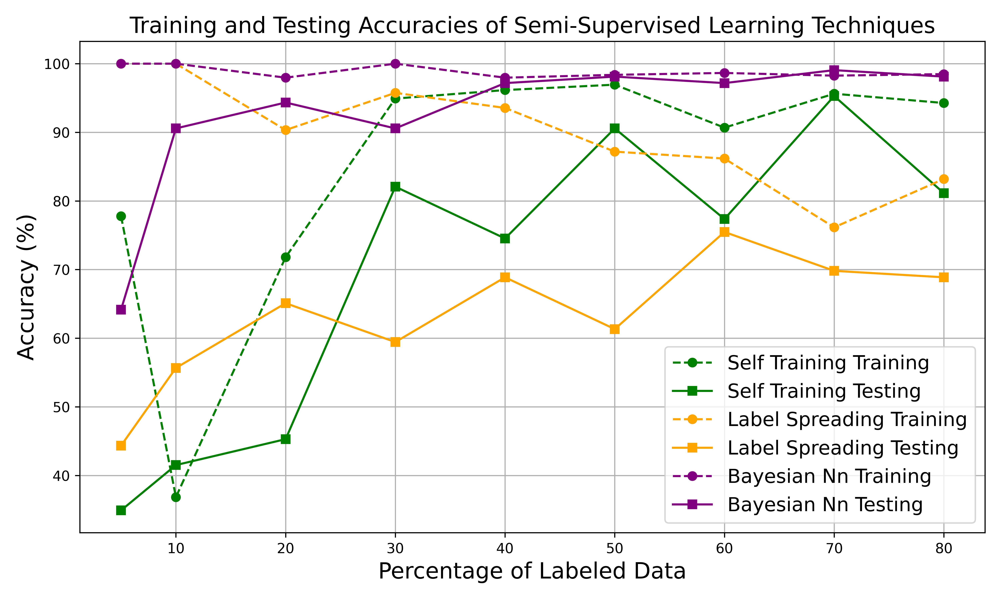

::: {.ppr-meta}
Power Systems Engineering Center, National Renewable Energy Laboratory (NREL) · *IEEE PES General Meeting 2025*, Austin, TX
:::

```{=html}
<div class="ppr-actions">
  <a href="https://doi.org/10.1109/PESGM52009.2025.11225667" target="_blank" rel="noopener"><i class="bi bi-file-earmark-pdf-fill"></i> Paper (IEEE Xplore)</a>
  <a class="a-poster" href="/misc/info/posters/SSL_PESGM_poster.pdf" target="_blank" rel="noopener"><i class="bi bi-image-fill"></i> Poster</a>
  <a class="a-slides" href="/misc/info/presentations/SSL_PESGM_presentation.pdf" target="_blank" rel="noopener"><i class="bi bi-easel2-fill"></i> Slides</a>
  <a class="a-cite" href="#cite"><i class="bi bi-quote"></i> Cite</a>
</div>
```

::: {.tldr}
[TL;DR]{.k}

Utilities often don't know which phase each customer's meter is connected to, and the few labels they have are expensive and partly wrong. We compare three semi-supervised learners (self-training, label spreading, and a Bayesian neural network) that learn from a small labeled set plus many unlabeled meters, and we quantify how uncertain each prediction is. On real AMI data from Duquesne Light Company, the Bayesian neural network reaches about **98% ± 0.08 accuracy** and stays far ahead when labels are scarce.

```{=html}
<div class="stats">
  <div><b>64% vs 35–44%</b><span>accuracy with only 5% of meters labeled (BNN vs. other SSL methods)</span></div>
  <div><b>99.06%</b><span>peak BNN test accuracy, at 70% labeled data</span></div>
  <div><b>100</b><span>Monte Carlo forward passes per prediction to estimate uncertainty</span></div>
</div>
```
:::

## Why phase identification matters

Every single-phase customer in a distribution feeder hangs off one of the phases A, B, or C. Utilities need that mapping to balance load across phases, run accurate power-flow simulations, host more rooftop solar and other distributed energy resources (DERs), and localize faults. In practice the mapping in the utility's model is often **incomplete or out of date**, especially as new customers are added and crews reconfigure lines over the years.

Advanced metering infrastructure (AMI) gives us a time series of voltage and power from every meter, so phase identification can be cast as a learning problem. The catch is labels. Supervised methods work well[^sup] but need lots of verified phase labels, and each label usually means a field visit. A utility typically has **a small set of labels it trusts** and **a large pool of meters with no reliable label at all**.

[^sup]: Earlier NREL work showed supervised phase identification works on real feeders with high PV penetration when enough labeled data exists. Padullaparti et al., *IEEE PESGM* 2022.

That shape of data, few labels and many unlabeled points, is exactly what **semi-supervised learning (SSL)** is built for.[^survey] SSL has been used in power systems for fault and event classification, but existing work has two gaps:

[^survey]: J. E. van Engelen and H. H. Hoos, "A survey on semi-supervised learning," *Machine Learning*, 109, 373–440, 2020.

1. **No robust uncertainty quantification.** A model that says "phase B" without saying *how sure* it is gives an operator no way to decide which predictions to trust and which meters to verify in the field.
2. **Performance collapses with very few labels**, which is precisely the regime utilities live in.

{#fig-ssl width=90%}

### What this paper contributes

- **A comparative SSL framework** that combines and benchmarks self-training, label spreading, and Bayesian neural networks (BNNs) for phase identification.
- **Epistemic and aleatoric uncertainty** estimated for every prediction, so decisions can be weighted by confidence.[^unc]
- **A custom BNN** with Bayesian layers and Monte Carlo sampling built for this task.
- **A labeled-data sweep from 5% to 80%**, showing how much labeled data each method actually needs for reliable phase identification.

[^unc]: On why separating the two kinds of uncertainty matters, see Wimmer et al., "Quantifying aleatoric and epistemic uncertainty in machine learning," 2023.

## Problem formulation

We frame phase identification as a **semi-supervised classification** problem. The dataset is split into a small labeled part and a large unlabeled part,

$$
\mathcal{D} = \mathcal{D}_L \cup \mathcal{D}_U, \qquad
\mathcal{D}_L = \{(\mathbf{x}_i, y_i)\}_{i=1}^{n_L}, \quad
\mathcal{D}_U = \{\mathbf{x}_j\}_{j=1}^{n_U}, \quad n_L \ll n_U,
$$

where each $\mathbf{x}_i \in \mathbb{R}^d$ holds standardized electrical features of one meter (power, voltage, impedance) and $y_i$ is its phase. The goal is a classifier $f:\mathbb{R}^d \rightarrow \{A, B, C\}$ trained on **both** parts by minimizing

$$
\min_{f} \left( \frac{1}{n_L} \sum_{i=1}^{n_L} \mathcal{L}\big(f(\mathbf{x}_i), y_i\big) \;+\; \lambda \cdot \mathcal{R}\big(f, \mathcal{D}_U\big) \right)
$$ {#eq-objective}

::: {.column-margin}
**Reading @eq-objective.** The first term is ordinary supervised loss (cross-entropy) on the trusted labels. The second term, $\mathcal{R}$, rewards a classifier that is *consistent with the structure of the unlabeled data*. $\lambda$ sets how much we lean on that structure.
:::

Each of the three methods below is a different way of building that unlabeled-data term. On top of the predicted label $\hat{y}_i$, we also return a confidence score $\sigma_i$ for every meter.

::: {.column-margin}
In general a meter can sit on one of six phase connections: A, B, C, AB, BC, or AC. Our filtered dataset keeps only single-phase meters, so the classifier predicts A, B, or C.
:::

## Data pipeline: from a CYME model to features

### Data preparation

We received the utility's feeder model in **CYME**, converted it to **OpenDSS** to extract the smart-meter mapping and the network topology that determines impedance, and exported everything to CSV. The raw dataset is

$$
\mathcal{D} = \{(\mathbf{x}_i, y_i)\}_{i=1}^{N}, \qquad \mathbf{x}_i \in \mathbb{R}^m,\; y_i \in \mathbb{Y} = \{A, B, C, AB, BC, AC\}.
$$ {#eq-dataset}

### Filtering and feature selection

A filtering rule $C$ keeps only the samples we can use. It drops rows with missing values and feeders without three-phase data, which leaves single-phase meters:

$$
\mathcal{D}' = \{(\mathbf{x}_i, y_i) \in \mathcal{D} \mid C(\mathbf{x}_i, y_i) = \text{True}\}.
$$ {#eq-filter}

From $\mathcal{D}'$ we keep eight features per meter:

$$
F = \{R_0,\, X_0,\, R_1,\, X_1,\, P,\, \text{Max } V,\, \text{Min } V,\, \text{AVG } V\}.
$$ {#eq-features}

```{=html}
<table class="hp">
  <thead><tr><th>Feature</th><th>Meaning</th><th>Source</th></tr></thead>
  <tbody>
    <tr><td>R₀, X₀</td><td>Zero-sequence resistance and reactance from the substation to the meter</td><td>OpenDSS model</td></tr>
    <tr><td>R₁, X₁</td><td>Positive-sequence resistance and reactance</td><td>OpenDSS model</td></tr>
    <tr><td>P</td><td>Active power at the meter over the period T</td><td>AMI data</td></tr>
    <tr><td>Max V, Min V, AVG V</td><td>Maximum, minimum, and average voltage over T</td><td>AMI data</td></tr>
  </tbody>
</table>
```

::: {.column-margin}
**Why impedance helps.** Meters on the same phase share upstream conductors, so their voltages move together and their path impedances to the substation are related. Combining measured voltage statistics with modeled impedance gives the classifier both behavioral and physical evidence.
:::

{#fig-framework width=88%}

{#fig-topology width=85%}

### Train and test splits

$\mathcal{D}'$ is split **70% / 30%** into a development set $\mathcal{D}_{dev}$ and a held-out test set $\mathcal{D}_{test}$. Inside $\mathcal{D}_{dev}$ we reveal labels for only a fraction $p$ of meters, sweeping $p \in \{5\%, 10\%, 20\%, \dots, 80\%\}$, and hide the rest so they act as unlabeled data.

{#fig-split width=85%}

::: {.column-margin}
**Scale check.** The development set holds 247 meters (12 + 235 at 5%). Every test accuracy in @tbl-results is a multiple of about 0.94%, which matches a test set of **106 meters**. For example, 64.15% is 68 of 106 and 99.06% is 105 of 106.
:::

## Three semi-supervised learners

```{=html}
<div class="cards3">
  <div class="m-st"><h4>Self-training</h4><p>Train on the labels, predict the rest, keep only confident guesses, retrain. <em>Grows the labeled set.</em></p></div>
  <div class="m-ls"><h4>Label spreading</h4><p>Build a similarity graph and let labels diffuse to nearby meters. <em>Uses the shape of the data.</em></p></div>
  <div class="m-bnn"><h4>Bayesian neural network</h4><p>Learn a distribution over weights rather than a single network. <em>Knows what it doesn't know.</em></p></div>
</div>
```

### 1. Self-training with an ensemble of MLPs

**Intuition.** Start with the few labels you trust, let the model label everything else, and add only the predictions it is very confident about. Repeat. The labeled set grows without anyone visiting a meter.

An MLP classifier $f$ is first trained on $\mathcal{D}_L$:

$$
\theta = \arg\min_{\theta} \sum_{(\mathbf{x}_i, y_i) \in \mathcal{D}_L} \mathcal{L}\big(f(\mathbf{x}_i; \theta),\, y_i\big).
$$ {#eq-st-train}

It then predicts a label for every unlabeled meter,

$$
\hat{y}_j = f(\mathbf{x}_j; \theta) \qquad \forall j \in \{1, \dots, n_U\},
$$ {#eq-st-predict}

and only predictions whose class probability clears a threshold $\tau$ become pseudo-labels:

$$
\mathcal{D}_L^{\text{new}} = \{(\mathbf{x}_j, \hat{y}_j) \mid p_j > \tau\}.
$$ {#eq-st-confident}

$\mathcal{D}_L$ and $\mathcal{D}_L^{\text{new}}$ are merged and training repeats.

::: {.column-margin}
**The risk.** If an early pseudo-label is wrong, the model is retrained on its own mistake and can reinforce it. This is called *confirmation bias*, and it is why the threshold $\tau$ matters so much. The results section shows this happening.
:::

```{=html}
<table class="hp">
  <thead><tr><th>Setting</th><th>Value</th></tr></thead>
  <tbody>
    <tr><td>Architecture</td><td>Two-layer MLP, 64 → 32 units, ReLU</td></tr>
    <tr><td>Optimizer</td><td>Adaptive learning rate starting at 0.001, L2 regularization α = 0.001</td></tr>
    <tr><td>Pseudo-label threshold</td><td>τ = 0.85</td></tr>
    <tr><td>Self-training iterations</td><td>5</td></tr>
    <tr><td>Early stopping</td><td>20% of D<sub>L</sub> held out for validation; stop after 10 iterations without improvement</td></tr>
  </tbody>
</table>
```

### 2. Label spreading on a similarity graph

**Intuition.** Meters that look electrically alike probably share a phase. Build a graph where similar meters are strongly connected, then let the known labels flow along the edges until the graph settles.

The edge weight between meters $i$ and $j$ is a Gaussian of their distance, with $\sigma$ setting the scale:

$$
W_{ij} =
\begin{cases}
\exp\!\left(-\dfrac{\lVert \mathbf{x}_i - \mathbf{x}_j \rVert^2}{\sigma^2}\right), & i \neq j,\\[6pt]
0, & i = j.
\end{cases}
$$ {#eq-ls-graph}

Known labels seed a label matrix and unlabeled rows start at zero:

$$
Y_{ij} =
\begin{cases}
y_i, & \text{if } i \text{ is labeled},\\
0, & \text{if } i \text{ is unlabeled}.
\end{cases}
$$ {#eq-ls-init}

Labels then propagate with the update rule

$$
Y^{(t+1)} = (1 - \alpha)\, Y^{(t)} + \alpha\, D\, W\, Y^{(t)},
$$ {#eq-ls-update}

where $D$ is the diagonal degree matrix and $\alpha$ trades off keeping the current labels against adopting the neighbors' labels. Iteration stops when $\lVert Y^{(t+1)} - Y^{(t)} \rVert < \epsilon$.

::: {.column-margin}
**Spreading vs. propagation.** *Label propagation* clamps the known labels so they never change. *Label spreading* lets them soften a little through the clamping factor α. That softening helps when some utility labels are wrong, because one bad label can't dominate its neighborhood.
:::

```{=html}
<table class="hp">
  <thead><tr><th>Setting</th><th>Value</th></tr></thead>
  <tbody>
    <tr><td>Kernel</td><td>k-nearest neighbors, 2 neighbors</td></tr>
    <tr><td>Kernel weight</td><td>γ = 0.9</td></tr>
    <tr><td>Label clamping</td><td>α = 0.1</td></tr>
    <tr><td>Robustness</td><td>Gaussian noise (scale 0.01) added to training features; only 80% of labels used, the rest treated as unlabeled</td></tr>
    <tr><td>Convergence</td><td>Tolerance 0.0001, at most 5 iterations, ε ≈ 0.001</td></tr>
    <tr><td>Validation</td><td>20% stratified split</td></tr>
  </tbody>
</table>
```

### 3. Bayesian neural networks

**Intuition.** An ordinary network learns one value per weight. A BNN learns a *distribution* per weight. Running the network many times with different sampled weights gives a spread of answers, and that spread tells us how much to trust the prediction.

We place a Gaussian prior over the weights,

$$
p(W) = \mathcal{N}\big(W \mid \mu_W,\, \sigma_W^2\big),
$$ {#eq-bnn-prior}

define the likelihood of the labeled data,

$$
p(\mathbf{y} \mid X, W) = \prod_{i=1}^{n_L} \mathcal{N}\big(y_i \mid f(\mathbf{x}_i, W),\, \sigma^2\big),
$$ {#eq-bnn-lik}

where $\sigma^2$ captures noise in the data itself, and update our beliefs with Bayes' rule:

$$
p(W \mid \mathcal{D}_L) \propto p(\mathcal{D}_L \mid W)\, p(W).
$$ {#eq-bnn-post}

To classify a new meter $\mathbf{x}$ we average over every plausible network, weighted by the posterior:

$$
p(y^* \mid \mathbf{x}, \mathcal{D}_L) = \int p(y^* \mid \mathbf{x}, W)\, p(W \mid \mathcal{D}_L)\, dW.
$$ {#eq-bnn-pred}

That integral has no closed form, so we approximate it with **Monte Carlo dropout**: keep dropout switched on at inference, run $N$ stochastic forward passes, and average:

$$
\hat{y}^* = \frac{1}{N} \sum_{n=1}^{N} f(\mathbf{x}; W_n).
$$ {#eq-mc}

::: {.column-margin}
**Why ρ = −3?** Each weight's standard deviation is parameterized as $\sigma = \log(1 + e^{\rho})$, which keeps it positive. With $\rho = -3$:

$\sigma = \log(1 + e^{-3}) \approx 0.049$

This is a small initial uncertainty, enough to explore without destabilizing early training.
:::

```{=html}
<table class="hp">
  <thead><tr><th>Setting</th><th>Value</th></tr></thead>
  <tbody>
    <tr><td>Layers</td><td>Input (8 features) → Bayesian 64 → dropout → Bayesian 32 → dropout → softmax over phases</td></tr>
    <tr><td>Bayesian weights</td><td>Gaussian weights and biases; μ initialized at 0.0, ρ at −3 (Kaiming normal)</td></tr>
    <tr><td>Optimizer</td><td>Adam, learning rate 0.001, weight decay 0.01</td></tr>
    <tr><td>Dropout</td><td>0.7 retention rate</td></tr>
    <tr><td>Inference</td><td>N = 100 stochastic forward passes, softmax-normalized</td></tr>
  </tbody>
</table>
```

### 4. Two kinds of uncertainty

From the $N$ Monte Carlo predictions we compute

$$
U_{\text{epistemic}} = \operatorname{Var}\big(\hat{y}^*\big),
$$ {#eq-epi}

$$
U_{\text{aleatoric}} = \mathbb{E}\!\left[\big(\hat{y}^* - \mathbb{E}[\hat{y}^*]\big)^2\right].
$$ {#eq-ale}

::: {.insight}
[What each one tells a utility]{.k}

**Epistemic uncertainty** is *the model doesn't know*. It is high when a meter looks unlike anything in the labeled set, and it **shrinks with more labels**, so it points to which meters are worth a field visit.

**Aleatoric uncertainty** is *the data can't tell*. It comes from noise in the measurements themselves, so more labels won't remove it, and it flags meters whose AMI data may need cleaning.
:::

The full procedure:

```{=html}
<div class="algo">
  <div class="t">Algorithm 1 · Semi-supervised phase identification</div>
  <ol>
    <li><span class="kw">Input:</span> dataset D = {(xᵢ, yᵢ)}ᵢ₌₁ᴺ, label percentages P</li>
    <li><span class="kw">Output:</span> accuracies, predictions, uncertainties</li>
    <li>Filter D → D′; extract features X and labels Y</li>
    <li>Split D′ into D<sub>dev</sub>, D<sub>test</sub> (70 : 30)</li>
    <li><span class="kw">for</span> p ∈ P <span class="kw">do</span></li>
    <li class="in1">Select n = |D<sub>dev</sub>| × p/100 labeled samples</li>
    <li class="in1">Form D<sub>labeled</sub>, D<sub>unlabeled</sub> from D<sub>dev</sub></li>
    <li class="in1">X<sub>semi</sub> = X<sub>labeled</sub> ∪ X<sub>unlabeled</sub></li>
    <li class="in1">y<sub>semi</sub> = [y<sub>labeled</sub>, −1, …, −1]</li>
    <li class="in1">Run self-training and label spreading on (X<sub>semi</sub>, y<sub>semi</sub>)</li>
    <li class="in1">Run BNN on (X<sub>labeled</sub>, y<sub>labeled</sub>)</li>
    <li class="in1">Evaluate all methods on D<sub>test</sub></li>
    <li><span class="kw">end for</span></li>
    <li><span class="kw">return</span> results for each label percentage in P</li>
  </ol>
</div>
```

::: {.column-margin}
**The −1 convention.** Unlabeled meters are marked with label −1, which semi-supervised libraries such as scikit-learn treat as "unknown". Self-training and label spreading see all meters. The BNN trains only on the labeled ones and relies on its uncertainty to generalize.
:::

## Results

::: {#tbl-results}
```{=html}
<table class="res table">
  <thead>
    <tr><th>Labeled data</th><th>Self-training</th><th>Label spreading</th><th>BNN</th></tr>
  </thead>
  <tbody>
    <tr><td>5%</td><td>34.91 ± 0.11</td><td>44.34 ± 0.16</td><td class="best">64.15 ± 0.14</td></tr>
    <tr><td>10%</td><td>41.51 ± 0.12</td><td>55.66 ± 0.13</td><td class="best">90.57 ± 0.11</td></tr>
    <tr><td>20%</td><td>45.28 ± 0.11</td><td>65.09 ± 0.11</td><td class="best">94.34 ± 0.10</td></tr>
    <tr><td>30%</td><td>82.08 ± 0.12</td><td>59.43 ± 0.09</td><td class="best">90.57 ± 0.09</td></tr>
    <tr><td>40%</td><td>74.53 ± 0.11</td><td>68.87 ± 0.09</td><td class="best">97.17 ± 0.07</td></tr>
    <tr><td>50%</td><td>90.57 ± 0.13</td><td>61.32 ± 0.08</td><td class="best">98.11 ± 0.06</td></tr>
    <tr><td>60%</td><td>77.36 ± 0.12</td><td>75.47 ± 0.08</td><td class="best">97.17 ± 0.06</td></tr>
    <tr><td>70%</td><td>95.28 ± 0.10</td><td>69.81 ± 0.08</td><td class="best">99.06 ± 0.06</td></tr>
    <tr><td>80%</td><td>81.13 ± 0.10</td><td>68.87 ± 0.08</td><td class="best">98.11 ± 0.07</td></tr>
  </tbody>
</table>
```

Test accuracy (%) with uncertainty for each method as the share of labeled data grows. The best method in every row is highlighted, and it is the BNN in every case.
:::

{#fig-results width=100%}

### What the numbers say

**BNNs win when labels are scarce.** With only **5%** of meters labeled (12 meters), the BNN reaches **64.15%**, against 34.91% for self-training and 44.34% for label spreading. At **10%** it jumps to **90.57%** while the others are still below 56%. It peaks at **99.06%** with 70% labeled data.

::: {.column-margin}
In practice, at 10% labels the BNN gets about 96 of 106 test meters right. Self-training gets about 44.
:::

**Self-training is unstable.** Its accuracy is not monotone in the amount of labeled data. It goes from 82.08% at 30% to 74.53% at 40%, and from 95.28% at 70% to 81.13% at 80%. The fixed 0.85 pseudo-label threshold lets confident but wrong labels into the training set, and the model overfits to them.

**Label spreading plateaus.** It improves early but levels off around 70% accuracy. A graph built on only two nearest neighbors captures local structure well but can't express more complex boundaries between phases.

### Why the BNN wins

::: {.insight}
[Key insight]{.k}

Treating weights as **distributions** gives the BNN a built-in guard against the failure that hurts self-training. It never commits hard to a single early guess, so errors don't compound. Its effective complexity also adapts to the amount of data: with few labels the posterior stays broad and the model is cautious, and as labels arrive the posterior narrows and the model becomes confident.
:::

Self-training and label spreading still earn their place. Self-training grows the labeled set cheaply, and label spreading uses the geometry of the unlabeled data. Together with a BNN they give a path **from a handful of trusted labels to a well-calibrated classifier**, while flagging the predictions that need a human check.

## Conclusion

Phase identification doesn't need a fully labeled feeder. A Bayesian neural network trained on a small, partly unreliable set of labels reaches **about 98% ± 0.08 accuracy** on real utility AMI data and attaches an uncertainty to every prediction. The labeled-data sweep also gives utilities a practical answer to *how many meters they need to verify*: by about 10–20% labeled data, the BNN is already above 90%.

::: {.column-margin}
**For practitioners.** Use epistemic uncertainty to prioritize field verification. Verify the meters the model is least sure about first, then retrain. Each verified meter then teaches the model as much as possible.
:::

## Cite this work {#cite}

> K. Kumar, K. Utkarsh, J. Wang and H. V. Padullaparti, "Advanced Semi-Supervised Learning With Uncertainty Estimation for Phase Identification in Distribution Systems," *2025 IEEE Power & Energy Society General Meeting (PESGM)*, Austin, TX, USA, 2025, pp. 1–5, doi: [10.1109/PESGM52009.2025.11225667](https://doi.org/10.1109/PESGM52009.2025.11225667).

```bibtex
@inproceedings{kumar2025ssl_phase,
  author    = {Kumar, Kundan and Utkarsh, Kumar and Wang, Jiyu and Padullaparti, Harsha Vardhana},
  title     = {Advanced Semi-Supervised Learning With Uncertainty Estimation for Phase Identification in Distribution Systems},
  booktitle = {2025 IEEE Power \& Energy Society General Meeting (PESGM)},
  year      = {2025},
  pages     = {1--5},
  address   = {Austin, TX, USA},
  doi       = {10.1109/PESGM52009.2025.11225667}
}
```

## Acknowledgments

This work was authored in part by the National Renewable Energy Laboratory (NREL) for the U.S. Department of Energy (DOE) under Contract No. DE-AC36-08GO28308. Funding was provided by the U.S. DOE Office of Electricity under Agreement No. 102400X-FY23 TCF-23-20116. The views expressed do not necessarily represent the views of the DOE or the U.S. Government.

## References

1. H. Padullaparti, S. Veda, J. Wang, M. Symko-Davies, and T. Bialek, "Phase identification in real distribution networks with high PV penetration using advanced metering infrastructure data," *IEEE PESGM*, 2022.
2. H. Padullaparti, S. Veda, S. Dhulipala, M. Baggu, T. Bialek, and M. Symko-Davies, "Considerations for AMI-based operations for distribution feeders," *IEEE PESGM*, 2019.
3. N. Zaragoza, H. Chaoui, B. Nutter, and V. Rao, "Phase identification in power distribution systems via feature engineering," *IEEE Access*, vol. 11, pp. 118615–118624, 2023.
4. F. Olivier, A. Sutera, P. Geurts, R. Fonteneau, and D. Ernst, "Phase identification of smart meters by clustering voltage measurements," *PSCC*, 2018.
5. J. E. van Engelen and H. H. Hoos, "A survey on semi-supervised learning," *Machine Learning*, vol. 109, pp. 373–440, 2020. [doi](https://doi.org/10.1007/s10994-019-05855-6)
6. S. Li, Y. Zhang, F. Yang, and R. C. Qiu, "Fault classification in transmission network with semi-supervised learning method," *IEEE ISGT Europe*, 2021.
7. Y. Yuan, Y. Wang, and Z. Wang, "A data-driven framework for power system event type identification via safe semi-supervised techniques," *IEEE Trans. Power Systems*, vol. 39, no. 1, pp. 1460–1471, 2024.
8. Z. Wang, Y. Li, Y. Guo, L. Fang, and S. Wang, "Data-uncertainty guided multi-phase learning for semi-supervised object detection," 2021. [arXiv:2103.16368](https://arxiv.org/abs/2103.16368)
9. E. Goan and C. Fookes, "Bayesian neural networks: An introduction and survey," Springer, 2020, pp. 45–87. [doi](http://dx.doi.org/10.1007/978-3-030-42553-1_3)
10. L. Wimmer, Y. Sale, P. Hofman, B. Bischl, and E. Hüllermeier, "Quantifying aleatoric and epistemic uncertainty in machine learning," 2023. [arXiv:2209.03302](https://arxiv.org/abs/2209.03302)
