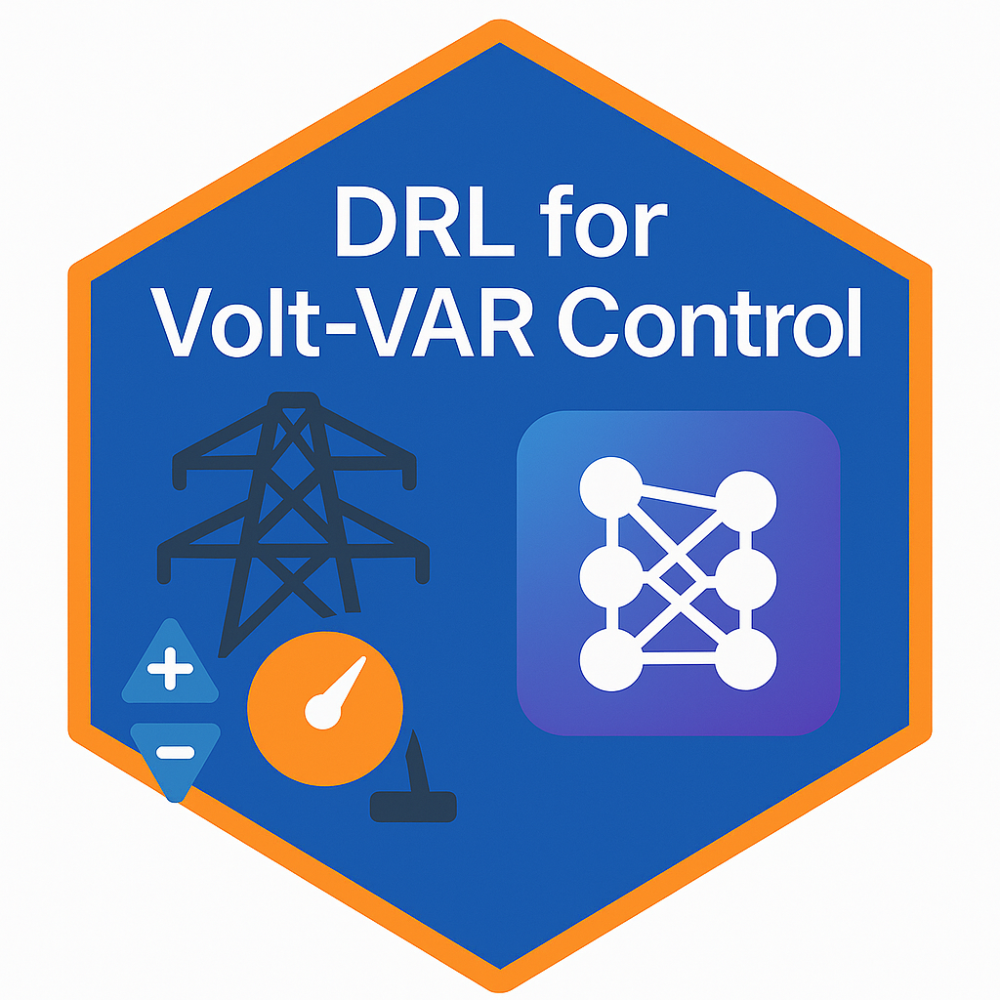
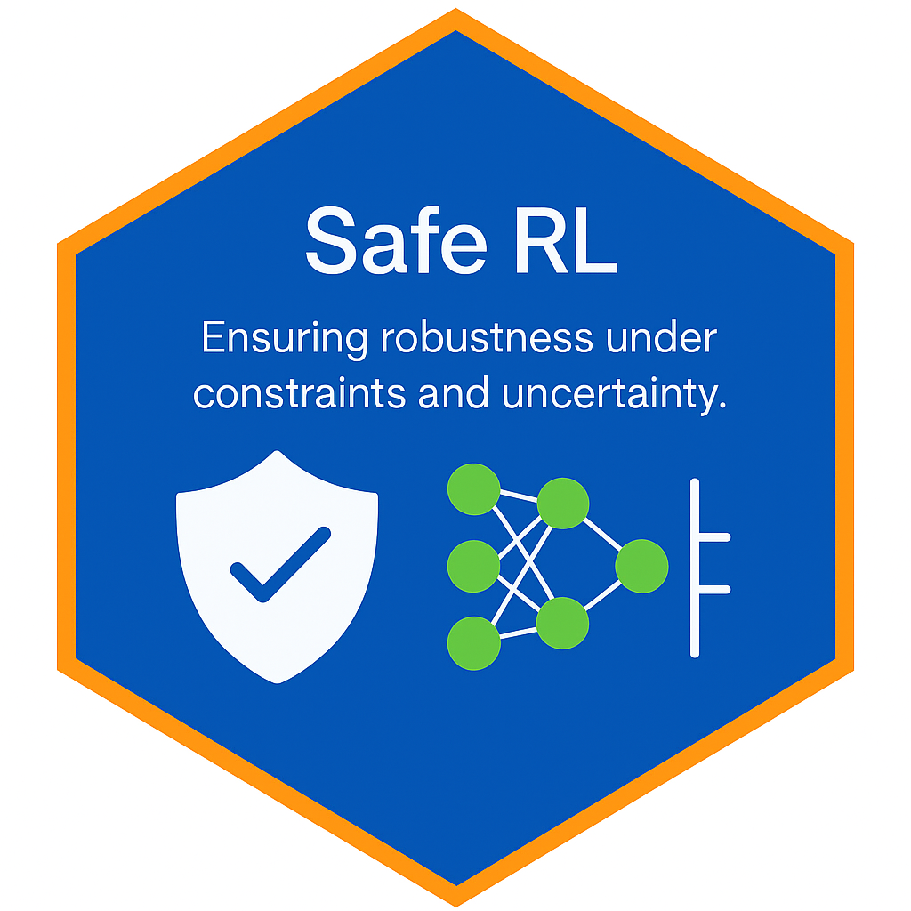
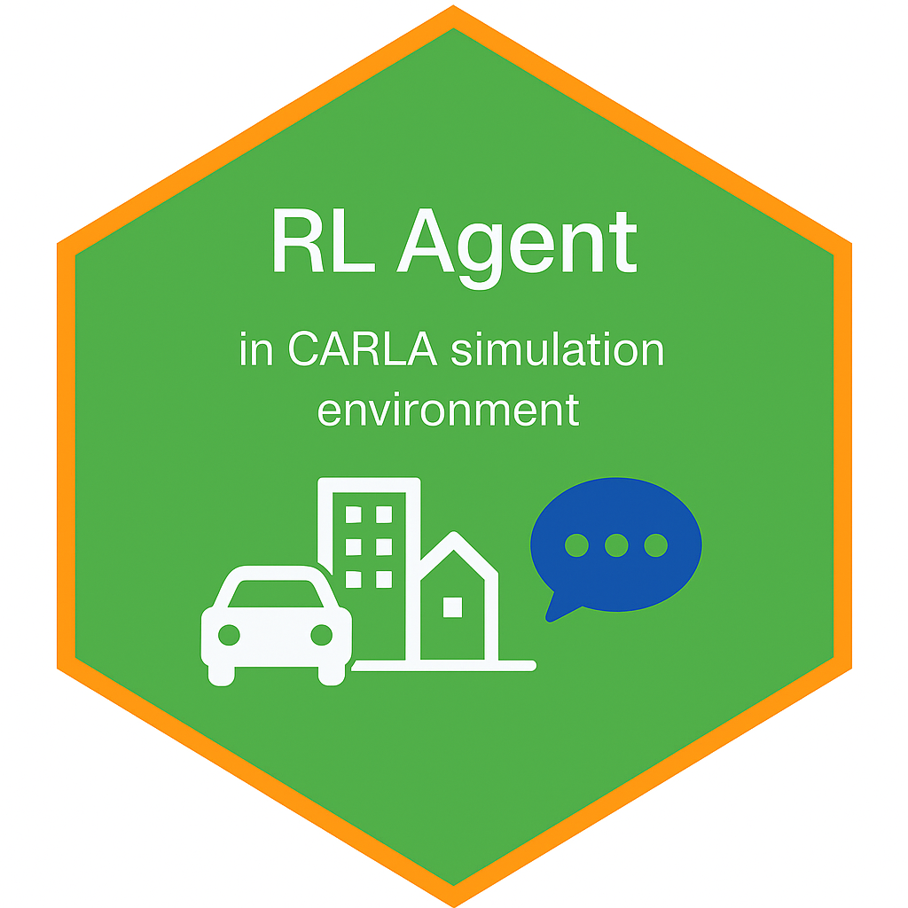

```{=html}
<style>
  /* ---------- thrust colors ---------- */
  .th-energy { --c: #b46939; }
  .th-safety { --c: #1f5fbf; }
  .th-vision { --c: #1f8f4d; }
  .th-other  { --c: #7b4fd6; }

  .rs-soft { background: color-mix(in srgb, var(--c) 9%, transparent); }

  /* ---------- hero ---------- */
  .rs-lead { font-size: 1.08rem; line-height: 1.7; }
  .rs-diss {
    border-left: 3px solid var(--bs-link-color);
    padding: 0.5rem 0.9rem;
    margin: 1rem 0;
    font-size: 0.92rem;
    background: color-mix(in srgb, var(--bs-link-color) 6%, transparent);
    border-radius: 0 6px 6px 0;
  }
  .rs-diss .k { font-size: 0.72rem; text-transform: uppercase; letter-spacing: 0.08em; color: var(--bs-secondary-color); display: block; }
  .rs-diss-title { color: var(--bs-body-color); text-decoration: none; }
  .rs-diss-title:hover { color: var(--bs-link-color); text-decoration: underline; text-underline-offset: 3px; }
  .rs-diss-btn {
    display: flex; width: fit-content; align-items: center; gap: 0.35rem;
    margin-top: 0.5rem; padding: 3px 11px;
    border: 1.5px solid var(--bs-link-color); border-radius: 999px;
    font-size: 0.78rem; font-weight: 600; text-decoration: none; color: var(--bs-link-color);
  }
  .rs-diss-btn:hover { background: var(--bs-link-color); color: #fff; }
  .rs-diss-btn .bi-box-arrow-up-right { font-size: 0.7rem; }
  .rs-links { display: flex; flex-wrap: wrap; gap: 0.5rem; margin: 1rem 0 0.4rem; }
  .rs-links a {
    --b: var(--bs-link-color);
    display: inline-flex; align-items: center; gap: 0.45rem;
    padding: 5px 14px;
    border: 1.5px solid color-mix(in srgb, var(--b) 55%, transparent);
    background: color-mix(in srgb, var(--b) 8%, transparent);
    border-radius: 999px;
    font-size: 0.85rem; font-weight: 600;
    text-decoration: none; color: var(--bs-body-color);
    transition: background-color .15s, color .15s, border-color .15s, transform .15s;
  }
  .rs-links a i { color: var(--b); font-size: 1.05rem; line-height: 1; transition: color .15s; }
  .rs-links a:hover { background: var(--b); border-color: var(--b); color: #fff; transform: translateY(-1px); }
  .rs-links a:hover i { color: #fff; }
  .lk-scholar { --b: #4285F4 !important; }
  .lk-orcid   { --b: #7FAF1B !important; }
  .lk-github  { --b: #24292f !important; }
  body.quarto-dark .lk-github { --b: #8b949e !important; }
  .lk-pubs    { --b: #b46939 !important; }
  .lk-cv      { --b: #c0392b !important; }
  .lk-mail    { --b: #d93025 !important; }
  .lk-contact { --b: #1f8f4d !important; }

  /* ---------- vision ---------- */
  .rs-goal {
    position: relative;
    padding: 1.2rem 1.4rem 1.2rem 3.2rem;
    margin: 1rem 0 1.2rem;
    border-radius: 12px;
    background: color-mix(in srgb, var(--bs-link-color) 7%, transparent);
    font-family: 'PT Serif', serif;
    font-size: 1.08rem;
    line-height: 1.6;
  }
  .rs-goal::before {
    content: "\201C"; position: absolute; left: 1rem; top: 0.2rem;
    font-size: 3.2rem; line-height: 1; color: var(--bs-link-color); opacity: 0.6;
  }
  .rs-goal .k {
    display: block; font-family: inherit; font-size: 0.72rem; text-transform: uppercase;
    letter-spacing: 0.1em; color: var(--bs-secondary-color); margin-bottom: 0.3rem;
    font-family: system-ui, sans-serif;
  }
  .rs-dirs { display: grid; grid-template-columns: repeat(3, 1fr); gap: 0.9rem; margin: 0.8rem 0 1rem; }
  .rs-dir {
    border: 1px solid var(--bs-border-color); border-top: 4px solid var(--c);
    border-radius: 10px; padding: 1rem 1.05rem;
    display: flex; flex-direction: column;
  }
  .rs-dir .n { font-family: 'PT Serif', serif; font-size: 1.6rem; color: var(--c); line-height: 1; }
  .rs-dir h4 { font-size: 1rem; margin: 0.4rem 0 0.5rem; }
  .rs-dir dl { margin: 0; font-size: 0.86rem; }
  .rs-dir dt { font-size: 0.68rem; text-transform: uppercase; letter-spacing: 0.08em; color: var(--c); margin-top: 0.5rem; }
  .rs-dir dd { margin: 0.1rem 0 0; }
  .rs-why { font-size: 0.95rem; }
  .rs-pub-foot { display: flex; flex-wrap: wrap; justify-content: space-between; align-items: center; gap: 0.6rem; margin: 0.2rem 0 0.6rem; font-size: 0.86rem; color: var(--bs-secondary-color); }
  #rs-pubs .rs-pub:last-child { border-bottom: none; }
  .rs-full {
    display: inline-flex; align-items: center; gap: 0.4rem;
    padding: 6px 15px; border-radius: 999px;
    border: 1.5px solid var(--bs-link-color); color: var(--bs-link-color);
    font-size: 0.86rem; font-weight: 600; text-decoration: none; white-space: nowrap;
  }
  .rs-full:hover { background: var(--bs-link-color); color: #fff; }

  /* ---------- research map ---------- */
  .rs-map {
    display: grid;
    grid-template-columns: 1fr auto 1fr auto 1fr;
    align-items: stretch;
    gap: 0.4rem;
    margin: 1rem 0 0.5rem;
  }
  .rs-col h5 {
    font-size: 0.72rem; text-transform: uppercase; letter-spacing: 0.1em;
    color: var(--bs-secondary-color); margin: 0 0 0.5rem; text-align: center;
  }
  .rs-node {
    border: 1px solid var(--bs-border-color);
    border-radius: 8px;
    padding: 0.5rem 0.7rem;
    margin-bottom: 0.45rem;
    font-size: 0.86rem;
    line-height: 1.35;
  }
  .rs-node i { color: var(--bs-link-color); margin-right: 0.35rem; }
  .rs-col.mid .rs-node { text-align: center; font-weight: 600; }
  .rs-col.mid .rs-node small { display: block; font-weight: 400; color: var(--bs-secondary-color); font-size: 0.76rem; }
  .rs-arrow {
    display: flex; align-items: center; justify-content: center;
    color: var(--bs-secondary-color); font-size: 1.4rem; padding-top: 1.4rem;
  }
  .rs-col { display: flex; flex-direction: column; }
  .rs-col.right .rs-node {
    border-left: 4px solid var(--c);
    display: flex; align-items: center; gap: 0.55rem;
    padding: 0.7rem 0.8rem;
    background: color-mix(in srgb, var(--c) 6%, transparent);
  }
  .rs-col.right .rs-node:first-of-type { margin-top: auto; }
  .rs-col.right .rs-node:last-child { margin-bottom: auto; }
  .rs-col.right .rs-node i { color: var(--c); font-size: 1.2rem; margin: 0; }
  .rs-col.right .rs-node a { color: var(--bs-body-color); font-weight: 600; text-decoration: none; }
  .rs-col.right .rs-node a:hover { color: var(--c); text-decoration: underline; text-underline-offset: 3px; }

  /* ---------- thrusts ---------- */
  .rs-thrust {
    display: grid; grid-template-columns: 110px 1fr; gap: 1.2rem;
    border: 1px solid var(--bs-border-color);
    border-top: 4px solid var(--c);
    border-radius: 12px;
    padding: 1.2rem 1.3rem;
    margin: 1.1rem 0;
    transition: box-shadow .2s, transform .2s;
  }
  .rs-thrust:hover { box-shadow: 0 6px 18px rgba(0,0,0,0.08); transform: translateY(-2px); }
  .rs-thrust img { width: 110px; height: 110px; object-fit: contain; }
  .rs-thrust h3 { margin: 0 0 0.35rem; font-size: 1.2rem; }
  .rs-thrust h3 a { color: var(--c); text-decoration: none; }
  .rs-thrust h3 a:hover { text-decoration: underline; }
  .rs-thrust p { font-size: 0.93rem; margin-bottom: 0.55rem; }
  .rs-q { font-style: italic; color: var(--bs-secondary-color); font-size: 0.9rem; }
  .rs-tags span {
    display: inline-block; font-size: 0.74rem;
    padding: 1px 9px; margin: 0 4px 4px 0;
    border-radius: 999px; border: 1px solid color-mix(in srgb, var(--c) 45%, transparent);
    color: var(--c);
  }
  .rs-key { font-size: 0.83rem; margin-top: 0.4rem; color: var(--bs-secondary-color); }
  .rs-key b { color: var(--bs-body-color); }

  /* ---------- now / ongoing ---------- */
  .rs-now { display: grid; grid-template-columns: repeat(3, 1fr); gap: 0.9rem; margin: 1rem 0; }
  .rs-now > div {
    border: 1px solid color-mix(in srgb, var(--c) 35%, transparent);
    border-radius: 10px; padding: 1rem 1.05rem;
  }
  .rs-now .lab {
    font-size: 0.68rem; text-transform: uppercase; letter-spacing: 0.09em;
    color: var(--c); font-weight: 700; display: flex; align-items: center; gap: 0.4rem;
  }
  .rs-now .lab::before {
    content: ""; width: 8px; height: 8px; border-radius: 50%; background: var(--c);
    animation: rs-pulse 2s infinite;
  }
  @keyframes rs-pulse {
    0% { box-shadow: 0 0 0 0 color-mix(in srgb, var(--c) 60%, transparent); }
    70% { box-shadow: 0 0 0 7px transparent; }
    100% { box-shadow: 0 0 0 0 transparent; }
  }
  @media (prefers-reduced-motion: reduce) { .rs-now .lab::before { animation: none; } }
  .rs-now h4 { font-size: 0.95rem; margin: 0.45rem 0 0.35rem; }
  .rs-now p { font-size: 0.84rem; margin: 0; }

  /* ---------- publications ---------- */
  .rs-pub {
    display: grid; grid-template-columns: 88px 1fr; gap: 0.9rem;
    padding: 0.75rem 0; border-bottom: 1px dashed var(--bs-border-color);
  }
  .rs-venue {
    align-self: start; text-align: center;
    font-size: 0.72rem; font-weight: 700; letter-spacing: 0.03em;
    padding: 4px 4px; border-radius: 6px;
    color: var(--c); border: 1.5px solid var(--c);
  }
  .rs-venue small { display: block; font-weight: 500; font-size: 0.64rem; opacity: 0.85; }
  .rs-pub .t { font-weight: 600; line-height: 1.4; }
  .rs-pub .a { font-size: 0.86rem; color: var(--bs-secondary-color); }
  .rs-pub .a .me { color: var(--bs-body-color); font-weight: 700; text-decoration: underline; text-decoration-color: var(--bs-link-color); text-underline-offset: 3px; }
  .rs-pub .v { font-size: 0.86rem; font-style: italic; }
  .rs-badge {
    display: inline-block; font-size: 0.68rem; font-weight: 700; font-style: normal;
    padding: 0 7px; border-radius: 4px; margin-left: 0.3rem;
    background: color-mix(in srgb, #d97706 18%, transparent); color: #b45309;
  }
  .rs-act { margin-top: 0.3rem; display: flex; flex-wrap: wrap; gap: 0.35rem; }
  .rs-act a {
    font-size: 0.76rem; font-weight: 600; text-decoration: none;
    padding: 1px 9px; border-radius: 5px; border: 1px solid var(--bs-border-color);
    color: var(--bs-body-color);
  }
  .rs-act a:hover { border-color: var(--bs-link-color); color: var(--bs-link-color); }

  /* ---------- collaborate ---------- */
  .rs-cta {
    border: 1px solid var(--bs-border-color); border-radius: 12px;
    padding: 1.3rem 1.4rem; margin: 1.2rem 0;
    background: color-mix(in srgb, var(--bs-link-color) 5%, transparent);
  }
  .rs-cta p { margin-bottom: 0.6rem; }

  @media (max-width: 768px) {
    .rs-dirs { grid-template-columns: 1fr; }
    .rs-map { grid-template-columns: 1fr; }
    .rs-arrow { padding: 0; transform: rotate(90deg); }
    .rs-thrust { grid-template-columns: 1fr; }
    .rs-thrust img { width: 80px; height: 80px; }
    .rs-now { grid-template-columns: 1fr; }
    .rs-pub { grid-template-columns: 1fr; gap: 0.35rem; }
    .rs-venue { justify-self: start; padding: 2px 8px; }
  }
</style>
```

::: {.rs-lead}
I develop safe, interpretable, and adaptive AI systems for real-world cyber-physical environments that must operate under uncertainty, strict physical constraints, and adversarial conditions. My work sits at the intersection of **safe reinforcement learning**, **physics-informed AI**, **probabilistic modeling**, and **AI safety evaluation**, with a core focus on building systems that are robust, verifiable, and deployable at scale in safety-critical domains.
:::

```{=html}
<div class="rs-diss">
  <span class="k">Ph.D. Dissertation · Iowa State University · 2026</span>
  <a class="rs-diss-title" href="https://www.proquest.com/docview/3380874785" target="_blank" rel="noopener"><em>Safe, robust, and intelligent AI frameworks for autonomous control and optimization of DER-integrated cyber-physical smart energy systems</em></a>
  <a class="rs-diss-btn" href="https://www.proquest.com/docview/3380874785" target="_blank" rel="noopener"><i class="bi bi-book"></i> Read on ProQuest <i class="bi bi-box-arrow-up-right"></i></a>
</div>

<link rel="stylesheet" href="https://cdn.jsdelivr.net/npm/academicons@1.9.4/css/academicons.min.css">
<div class="rs-links">
  <a class="lk-scholar" href="https://scholar.google.com/citations?user=1zDpIJkAAAAJ" target="_blank" rel="noopener"><i class="ai ai-google-scholar"></i> Google Scholar</a>
  <a class="lk-orcid" href="https://orcid.org/0000-0002-3229-6649" target="_blank" rel="noopener"><i class="ai ai-orcid"></i> ORCID</a>
  <a class="lk-github" href="https://github.com/kundan-kumarr" target="_blank" rel="noopener"><i class="bi bi-github"></i> GitHub</a>
  <a class="lk-pubs" href="/publications/"><i class="bi bi-journal-bookmark-fill"></i> All publications</a>
  <a class="lk-cv" href="/cv.html"><i class="bi bi-file-earmark-person-fill"></i> CV</a>
</div>
```

## Research at a Glance {#glance}

How the pieces fit: the methods I build on, the properties I want every system to have, and where I apply them.

```{=html}
<div class="rs-map">
  <div class="rs-col left">
    <h5>Methods</h5>
    <div class="rs-node"><i class="bi bi-shield-check"></i>Safe &amp; constrained reinforcement learning</div>
    <div class="rs-node"><i class="bi bi-lightning-charge"></i>Physics-informed learning</div>
    <div class="rs-node"><i class="bi bi-bar-chart-steps"></i>Probabilistic modeling &amp; uncertainty quantification</div>
    <div class="rs-node"><i class="bi bi-search"></i>Behavioral &amp; mechanistic evaluation</div>
  </div>
  <div class="rs-arrow" aria-hidden="true"><i class="bi bi-arrow-right"></i></div>
  <div class="rs-col mid">
    <h5>Properties</h5>
    <div class="rs-node">Reliable<small>under uncertainty, noise, attacks</small></div>
    <div class="rs-node">Generalizable<small>across tasks, scales, shifts</small></div>
    <div class="rs-node">Interpretable<small>to operators and engineers</small></div>
    <div class="rs-node">Deployable<small>in large real-world systems</small></div>
  </div>
  <div class="rs-arrow" aria-hidden="true"><i class="bi bi-arrow-right"></i></div>
  <div class="rs-col right">
    <h5>Domains</h5>
    <div class="rs-node th-energy"><i class="bi bi-lightning-charge-fill"></i><a href="smart-energy.html">DER-integrated smart energy grids</a></div>
    <div class="rs-node th-safety"><i class="bi bi-robot"></i><a href="ai-safety.html">LLM agents and agentic systems</a></div>
    <div class="rs-node th-vision"><i class="bi bi-car-front-fill"></i><a href="vision-simulation.html">Autonomous and cyber-physical systems</a></div>
  </div>
</div>
```

## Research Vision {#vision}

```{=html}
<div class="rs-goal">
  <span class="k">Long-term goal</span>
  Build AI systems that are provably beneficial, auditable, and aligned with human values at scale: agents that stay robust under distribution shift and adversarial conditions, can be interpreted and corrected, and operate reliably in safety-critical environments.
</div>
```

::: {.rs-why}
The most important open problems in AI are not only about capability. They are about safety, verification, and alignment. My path into these problems runs through safety-critical control: in power grids, a learning-based controller that fails under noise or attack has physical consequences. That experience shapes how I approach AI safety more broadly. I treat constraints, uncertainty, and worst-case behavior as first-class design requirements, and I test systems for how they fail, not only for how well they perform.
:::

My research agenda builds on three directions:

```{=html}
<div class="rs-dirs">
  <div class="rs-dir th-energy">
    <span class="n">01</span>
    <h4>Safe &amp; constrained reinforcement learning</h4>
    <dl>
      <dt>Question</dt>
      <dd>How do we give RL agents safety guarantees that still hold under distribution shift and adversarial perturbation?</dd>
      <dt>Approach</dt>
      <dd>Formal safety constraints, physics-informed inductive biases, certified robustness, and safe exploration, validated on large-scale cyber-physical systems.</dd>
    </dl>
  </div>
  <div class="rs-dir th-safety">
    <span class="n">02</span>
    <h4>Scalable AI oversight</h4>
    <dl>
      <dt>Question</dt>
      <dd>How can we systematically catch reward hacking, sycophancy, and goal misgeneralization in deployed agentic systems?</dd>
      <dt>Approach</dt>
      <dd>Evaluation frameworks and behavioral benchmarks for agents, and safety monitors that transfer across models and settings.</dd>
    </dl>
  </div>
  <div class="rs-dir th-other">
    <span class="n">03</span>
    <h4>Mechanistic interpretability &amp; deceptive alignment</h4>
    <dl>
      <dt>Question</dt>
      <dd>Can we locate and detect hidden objectives, such as evaluation awareness, inside a model's internals?</dd>
      <dt>Approach</dt>
      <dd>Sparse autoencoders, activation patching, steering vectors (CAA), and probe transfer on open-weight language models.</dd>
    </dl>
  </div>
</div>
```

## Research Thrusts {#thrusts}

```{=html}
<div class="rs-thrust th-energy">
  
  <div>
    <h3><a href="smart-energy.html">Safe &amp; Intelligent Systems for Smart Energy</a></h3>
    <p class="rs-q">How can learning-based controllers keep a power grid stable when they face noise, faults, and attacks?</p>
    <p>Physics-informed deep RL, safe and uncertainty-aware control, LLM-guided planning, and sim-to-real transfer for smart grids and DER-integrated energy systems. Agents remain reliable under sensor noise, hardware faults, non-stationarity, and adversarial perturbations.</p>
    <div class="rs-tags"><span>Volt-VAR Control</span><span>Physics-Informed RL</span><span>Uncertainty Quantification</span><span>LLM Control</span><span>Domain Adaptation</span></div>
    <div class="rs-key"><b>Key work:</b> physics-based DRL for grid-resilient Volt-VAR control (IEEE TSG, under review) · attack-resilient DRL Volt-VAR control (ISGT 2024) · Bayesian BiLSTM wind forecasting with UQ (EPSR 2026)</div>
  </div>
</div>

<div class="rs-thrust th-safety">
  
  <div>
    <h3><a href="ai-safety.html">AI Safety &amp; Alignment</a></h3>
    <p class="rs-q">Can we tell when an AI agent behaves differently because it knows it is being evaluated?</p>
    <p>Behavioral and mechanistic evaluations to detect deceptive alignment, reward hacking, and eval-awareness in LLM agents, and scalable oversight frameworks for agentic systems in safety-critical deployments.</p>
    <div class="rs-tags"><span>Evaluation Awareness</span><span>Red-Teaming</span><span>Scalable Oversight</span><span>Monitor Transferability</span></div>
    <div class="rs-key"><b>Current work:</b> stress-testing eval-aware safety monitors, supported by an NSF ACCESS ACCELERATE allocation (CIS260799)</div>
  </div>
</div>

<div class="rs-thrust th-vision">
  
  <div>
    <h3><a href="vision-simulation.html">Vision &amp; Simulation for Autonomous Systems</a></h3>
    <p class="rs-q">How do we carry policies trained in simulation into the real world without losing safety?</p>
    <p>End-to-end perception-control pipelines, multimodal sensor fusion, and sim-to-real transfer using CARLA, AirSim, and OpenDSS for autonomous and cyber-physical systems.</p>
    <div class="rs-tags"><span>CARLA</span><span>Perception-Control</span><span>Multimodal Fusion</span><span>Sim-to-Real</span></div>
  </div>
</div>
```

## Ongoing Projects {#ongoing}

```{=html}
<div class="rs-now">
  <div class="th-energy rs-soft">
    <span class="lab">Smart Energy</span>
    <h4>Federated DRL for Cyber-Resilient Volt-VAR Optimization</h4>
    <p>Decentralized, communication-efficient control using LSTM-enhanced PPO agents across distributed DERs.</p>
  </div>
  <div class="th-safety rs-soft">
    <span class="lab">AI Safety</span>
    <h4>Stress-Testing Eval-Aware Safety Monitors</h4>
    <p>Probing LLM agents for eval-awareness via CAA on Nemotron-49B and Mistral; extending replication to silent model organisms. Supported by NSF ACCESS ACCELERATE (CIS260799).</p>
  </div>
  <div class="th-vision rs-soft">
    <span class="lab">LLM Control</span>
    <h4>LLM-Guided Autonomous Planning for Smart Buildings</h4>
    <p>Converting user prompts to interpretable control policies using LLMs (OpenAI, Claude) in CityLearn environments.</p>
  </div>
</div>
```

## Selected Publications {#publications}

```{=html}
<div class="rs-pub-foot">
  <span>2 journal · 8 conference · 1 workshop paper, including work under review</span>
  <a class="rs-full" href="/publications/"><i class="bi bi-journal-text"></i> Full Publications <i class="bi bi-arrow-right"></i></a>
</div>

<div id="rs-pubs">

<div class="rs-pub th-energy">
  <div class="rs-venue">IEEE TSG<small>Journal</small></div>
  <div>
    <div class="t">Physics-based Deep Reinforcement Learning for Grid-Resilient Volt-VAR Control</div>
    <div class="a"><span class="me">Kundan Kumar</span>, Gelli Ravikumar</div>
    <div class="v">IEEE Transactions on Smart Grid, 2025 <span class="rs-badge">Under review</span></div>
  </div>
</div>

<div class="rs-pub th-energy">
  <div class="rs-venue">EPSR<small>Journal</small></div>
  <div>
    <div class="t">Bayesian-optimized bidirectional long-short-term memory network for wind power forecasting with uncertainty quantification</div>
    <div class="a">Arif Hussain, <span class="me">Kundan Kumar</span>, Gelli Ravikumar</div>
    <div class="v">Electric Power Systems Research, 2026</div>
    <div class="rs-act"><a href="https://www.sciencedirect.com/science/article/pii/S037877962500848X" target="_blank" rel="noopener"><i class="bi bi-file-earmark-pdf"></i> Paper</a></div>
  </div>
</div>

<div class="rs-pub th-energy">
  <div class="rs-venue">ISGT<small>Conference</small></div>
  <div>
    <div class="t">Deep RL-based Volt-VAR Control and Attack Resiliency for DER-Integrated Distribution Grids</div>
    <div class="a"><span class="me">Kundan Kumar</span>, Gelli Ravikumar</div>
    <div class="v">IEEE Innovative Smart Grid Technologies (ISGT), 2024</div>
    <div class="rs-act"><a href="https://ieeexplore.ieee.org/document/10454163" target="_blank" rel="noopener"><i class="bi bi-file-earmark-pdf"></i> Paper</a></div>
  </div>
</div>

</div>
```

## Collaborate {#collaborate}

```{=html}
<div class="rs-cta">
  <p>I am interested in collaborations on safe reinforcement learning, physics-informed AI, AI safety evaluation, and learning-based control for energy and autonomous systems.</p>
  <div class="rs-links" style="margin:0">
    <a class="lk-mail" href="mailto:cs.kundann@gmail.com"><i class="bi bi-envelope-fill"></i> Email me</a>
    <a class="lk-contact" href="/contact.html"><i class="bi bi-chat-dots-fill"></i> Contact form</a>  </div>
</div>
```
