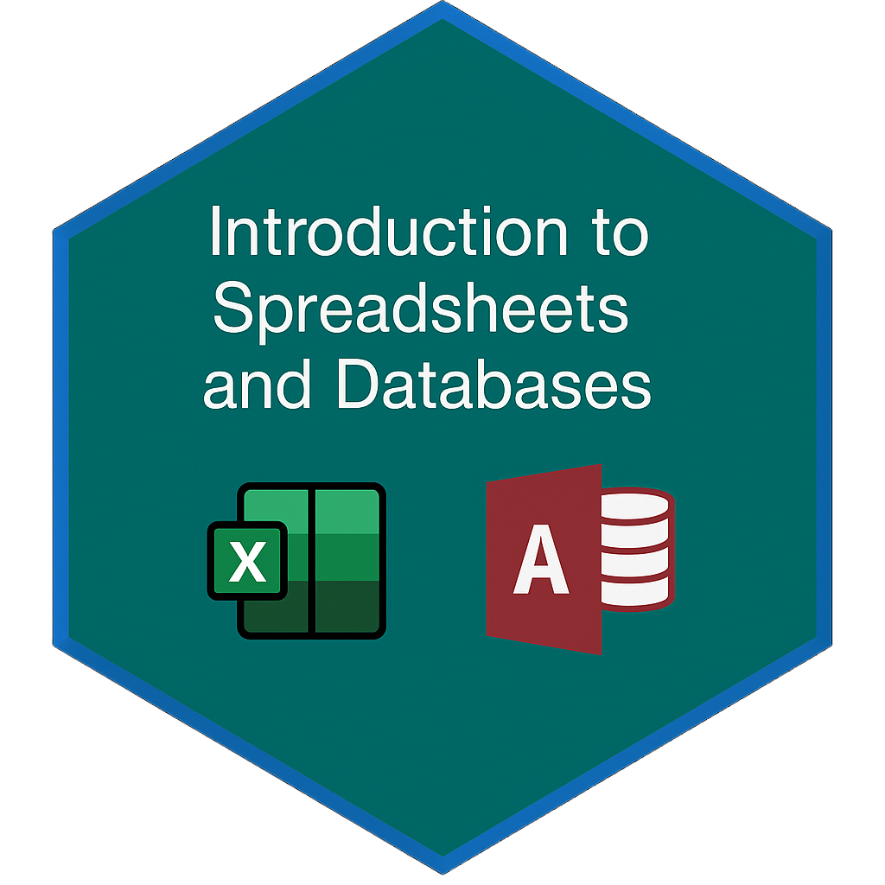
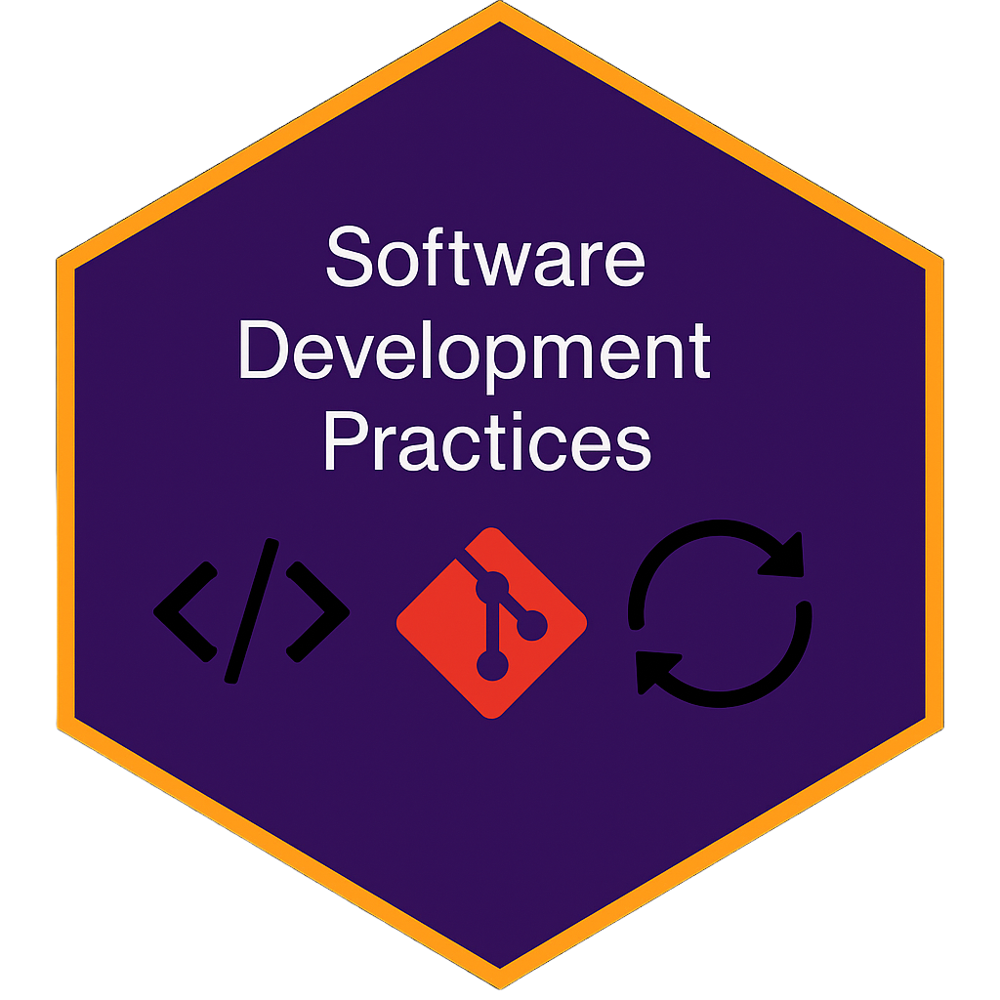
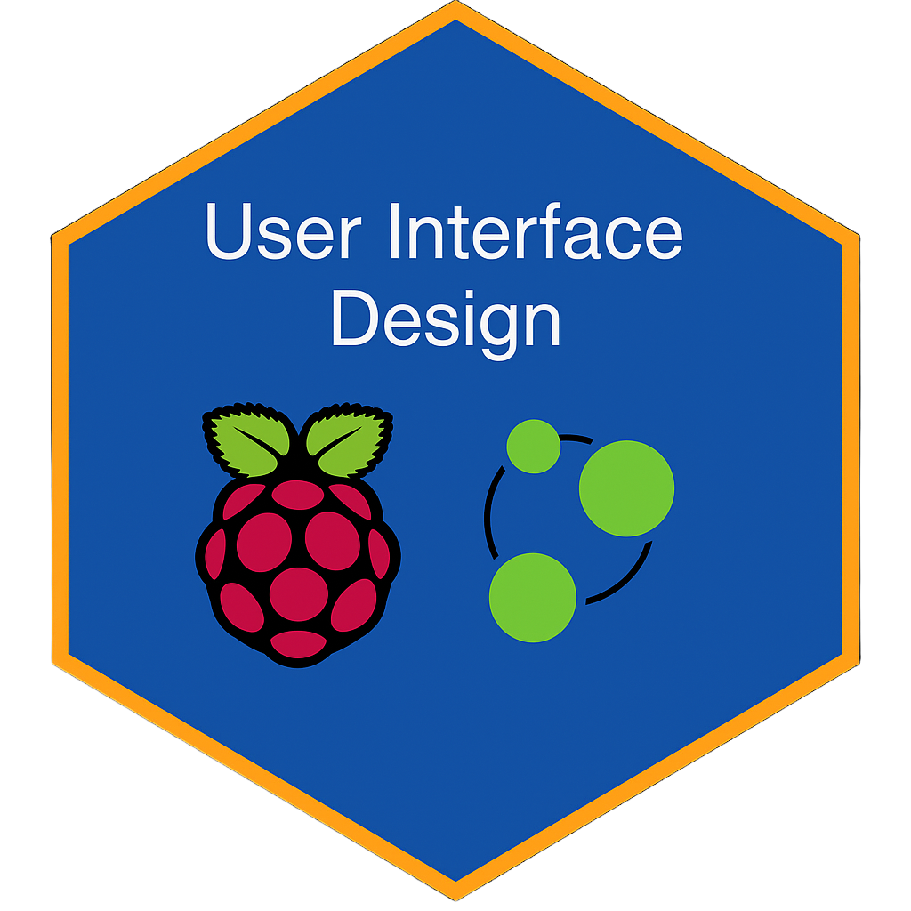
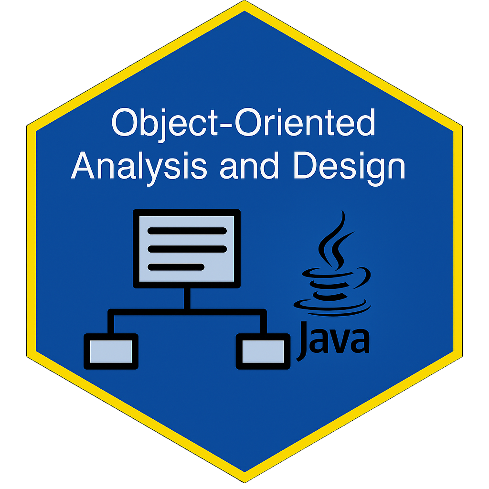
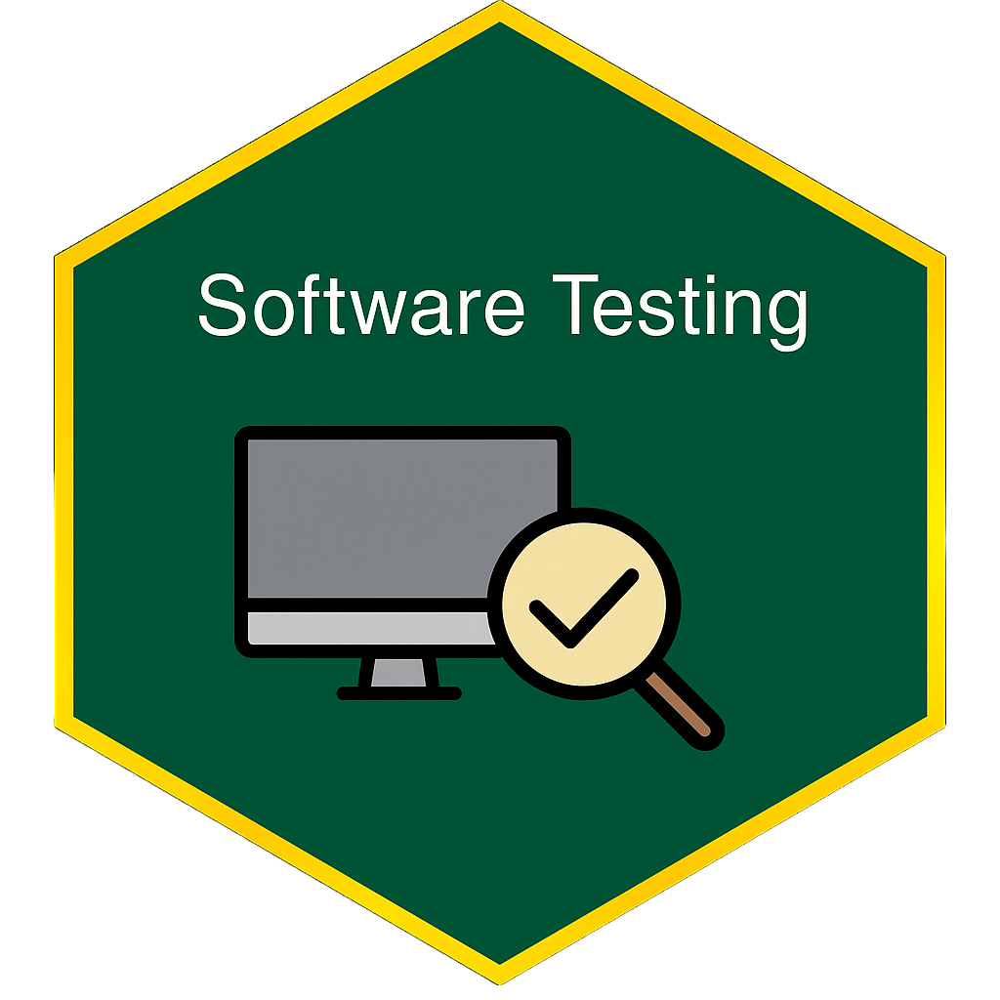

```{=html}
<style>
  /* ---------- per-course accent colors ---------- */
  .c1130 { --c: #2f8f6b; }
  .c3090 { --c: #d05808; }
  .c3190 { --c: #7b5ea7; }
  .c3620 { --c: #2b6cb0; }
  .c3630 { --c: #b8860b; }
  .c4170 { --c: #c0392b; }

  /* ---------- hero stats ---------- */
  .t-stats {
    display: flex;
    flex-wrap: wrap;
    gap: 0;
    margin: 1.6rem 0 0.4rem;
    border-top: 1px solid var(--bs-border-color);
    border-bottom: 1px solid var(--bs-border-color);
  }
  .t-stats > div {
    flex: 1 1 120px;
    padding: 0.9rem 0.6rem;
    text-align: center;
  }
  .t-stats > div + div { border-left: 1px solid var(--bs-border-color); }
  .t-stats strong {
    display: block;
    font-size: 1.9rem;
    line-height: 1.1;
    font-family: 'PT Serif', serif;
  }
  .t-stats span { font-size: 0.8rem; color: var(--bs-secondary-color); text-transform: uppercase; letter-spacing: 0.06em; }

  /* ---------- teaching map ---------- */
  .t-map-wrap { overflow-x: auto; margin: 0.6rem 0 0.4rem; padding-bottom: 0.3rem; }
  .t-map {
    display: grid;
    grid-template-columns: 7.2rem repeat(12, minmax(2.1rem, 1fr));
    gap: 4px;
    min-width: 560px;
    font-size: 0.78rem;
  }
  .t-map .yr {
    text-align: center;
    font-weight: 600;
    color: var(--bs-secondary-color);
    border-bottom: 2px solid var(--bs-border-color);
    padding-bottom: 2px;
  }
  .t-map .sem { text-align: center; color: var(--bs-secondary-color); }
  .t-map .lbl {
    display: flex; align-items: center;
    font-family: 'Source Code Pro', monospace;
    font-weight: 600;
    text-decoration: none;
    color: var(--c);
    white-space: nowrap;
  }
  .t-map .cell {
    height: 1.9rem;
    border-radius: 5px;
    border: 1px dashed var(--bs-border-color);
    opacity: 0.55;
  }
  .t-map a.cell {
    background: var(--c);
    border: none;
    opacity: 1;
    transition: transform 0.15s ease, box-shadow 0.15s ease;
  }
  .t-map a.cell:hover, .t-map a.cell:focus-visible {
    transform: scale(1.12);
    box-shadow: 0 3px 10px rgba(0,0,0,0.25);
  }
  .t-map-note { font-size: 0.82rem; color: var(--bs-secondary-color); }

  /* ---------- course cards (same layout as before) ---------- */
  .course-card {
    position: relative;
    border: 1px solid var(--bs-border-color);
    border-left: 5px solid var(--c);
    border-radius: 10px;
    padding: 1.1rem 1.2rem 0.9rem;
    margin: 1.1rem 0;
    transition: box-shadow 0.2s ease, transform 0.2s ease;
  }
  .course-card:hover { box-shadow: 0 6px 18px rgba(0,0,0,0.08); transform: translateY(-2px); }
  .course-card .grid { align-items: start; }
  .course-card img { border-radius: 8px; width: 100%; max-width: 120px; }
  .course-card h3 {
    margin-top: 0;
    font-size: 1.2rem;
  }
  .course-card h3 .code { color: var(--c); font-family: 'Source Code Pro', monospace; margin-right: 0.3rem; }
  .terms a {
    display: inline-block;
    font-size: 0.8rem;
    font-weight: 600;
    padding: 1px 10px;
    margin: 0 4px 4px 0;
    border-radius: 999px;
    border: 1.5px solid var(--c);
    color: var(--c);
    text-decoration: none;
  }
  .terms a:hover { background: var(--c); color: #fff; }
  .tags { margin-top: 0.3rem; }
  .tags span {
    display: inline-block;
    font-size: 0.75rem;
    padding: 1px 8px;
    margin: 0 4px 4px 0;
    border-radius: 4px;
    background: var(--bs-tertiary-bg, rgba(127,127,127,0.12));
    color: var(--bs-secondary-color);
  }

  /* ---------- principles + resources ---------- */
  .t-cards {
    display: grid;
    grid-template-columns: repeat(auto-fit, minmax(190px, 1fr));
    gap: 0.9rem;
    margin: 1rem 0;
  }
  .t-cards > div {
    border: 1px solid var(--bs-border-color);
    border-radius: 10px;
    padding: 1rem 1.05rem;
  }
  .t-cards .bi { font-size: 1.5rem; color: var(--bs-link-color); }
  .t-cards h4 { font-size: 1rem; margin: 0.5rem 0 0.35rem; }
  .t-cards p { font-size: 0.9rem; margin: 0; }
  .t-cards ul { font-size: 0.9rem; margin: 0; padding-left: 1.1rem; }
</style>
```

From 2020 to 2026 I served as a Computer Science Graduate Teaching Assistant at Iowa State University. My goal in every course was a comprehensive, engaging, and challenging learning environment that met the diverse needs of students, connecting theory with real-world practice so that core computer science concepts became practical skills.

::: {.t-stats}
::: {}
**6** [courses]{}
:::
::: {}
**12** [semesters]{}
:::
::: {}
**13** [offerings]{}
:::
::: {}
**4** [areas]{}
:::
:::

## Teaching Map

Every semester from Fall 2020 to Spring 2026, one row per course. Select a block to jump to that course.

```{=html}
<div class="t-map-wrap">
<div class="t-map" role="table" aria-label="Courses taught by semester, 2020 to 2026">
  <div></div>
  <div class="yr">2020</div>
  <div class="yr" style="grid-column: span 2">2021</div>
  <div class="yr" style="grid-column: span 2">2022</div>
  <div class="yr" style="grid-column: span 2">2023</div>
  <div class="yr" style="grid-column: span 2">2024</div>
  <div class="yr" style="grid-column: span 2">2025</div>
  <div class="yr">2026</div>

  <div></div>
  <div class="sem">Fall</div><div class="sem">Spr</div><div class="sem">Fall</div><div class="sem">Spr</div><div class="sem">Fall</div><div class="sem">Spr</div><div class="sem">Fall</div><div class="sem">Spr</div><div class="sem">Fall</div><div class="sem">Spr</div><div class="sem">Fall</div><div class="sem">Spr</div>

  <!-- order of columns: F20 S21 F21 S22 F22 S23 F23 S24 F24 S25 F25 S26 -->
  <a class="lbl c1130" href="#coms1130">COMS 1130</a>
  <a class="cell c1130" href="#coms1130" title="COMS 1130 · Fall 2020"></a><div class="cell"></div><div class="cell"></div><div class="cell"></div><div class="cell"></div><div class="cell"></div><div class="cell"></div><div class="cell"></div><div class="cell"></div><div class="cell"></div><div class="cell"></div><div class="cell"></div>

  <a class="lbl c3090" href="#coms3090">COMS 3090</a>
  <div class="cell"></div><div class="cell"></div><div class="cell"></div><div class="cell"></div><a class="cell c3090" href="#coms3090" title="COMS 3090 · Fall 2022"></a><a class="cell c3090" href="#coms3090" title="COMS 3090 · Spring 2023"></a><div class="cell"></div><a class="cell c3090" href="#coms3090" title="COMS 3090 · Spring 2024"></a><div class="cell"></div><div class="cell"></div><a class="cell c3090" href="#coms3090" title="COMS 3090 · Fall 2025"></a><div class="cell"></div>

  <a class="lbl c3190" href="#coms3190">COMS 3190</a>
  <div class="cell"></div><div class="cell"></div><div class="cell"></div><div class="cell"></div><div class="cell"></div><div class="cell"></div><a class="cell c3190" href="#coms3190" title="COMS 3190 · Fall 2023"></a><div class="cell"></div><div class="cell"></div><div class="cell"></div><div class="cell"></div><div class="cell"></div>

  <a class="lbl c3620" href="#coms3620">COMS 3620</a>
  <a class="cell c3620" href="#coms3620" title="COMS 3620 · Fall 2020"></a><a class="cell c3620" href="#coms3620" title="COMS 3620 · Spring 2021"></a><a class="cell c3620" href="#coms3620" title="COMS 3620 · Fall 2021"></a><div class="cell"></div><div class="cell"></div><div class="cell"></div><div class="cell"></div><div class="cell"></div><a class="cell c3620" href="#coms3620" title="COMS 3620 · Fall 2024"></a><div class="cell"></div><div class="cell"></div><div class="cell"></div>

  <a class="lbl c3630" href="#coms3630">COMS 3630</a>
  <div class="cell"></div><div class="cell"></div><div class="cell"></div><a class="cell c3630" href="#coms3630" title="COMS 3630 · Spring 2022"></a><div class="cell"></div><div class="cell"></div><div class="cell"></div><div class="cell"></div><div class="cell"></div><div class="cell"></div><div class="cell"></div><a class="cell c3630" href="#coms3630" title="COMS 3630 · Spring 2026"></a>

  <a class="lbl c4170" href="#coms4170">COMS 4170</a>
  <div class="cell"></div><div class="cell"></div><div class="cell"></div><div class="cell"></div><div class="cell"></div><div class="cell"></div><div class="cell"></div><div class="cell"></div><div class="cell"></div><a class="cell c4170" href="#coms4170" title="COMS 4170 · Spring 2025"></a><div class="cell"></div><div class="cell"></div>
</div>
</div>
```

## Courses

::: {.course-card .c1130 #coms1130}
::: {.grid}
::: {.g-col-12 .g-col-md-2}

:::
::: {.g-col-12 .g-col-md-10}
### [COMS 1130]{.code} Spreadsheets and Databases {.unnumbered}

[[Fall 2020](/teaching/coms1130/)]{.terms}

This foundational course focuses on using tools such as Microsoft Excel and Microsoft Access for effective data organization, analysis, and reporting. Students develop proficiency in applying formulas, creating pivot tables, designing queries, and building forms and visual analyses to support practical business and data-driven decision-making.

[[Excel]{} [Access]{} [Pivot tables]{} [Queries]{}]{.tags}
:::
:::
:::

::: {.course-card .c3090 #coms3090}
::: {.grid}
::: {.g-col-12 .g-col-md-2}

:::
::: {.g-col-12 .g-col-md-10}
### [COMS 3090]{.code} Software Development Practices {.unnumbered}

[[Fall 2022](/teaching/coms3090/) [Spring 2023](/teaching/coms3090/) [Spring 2024](/teaching/coms3090/) [Fall 2025](/teaching/coms3090/)]{.terms}

This course is a practical, **hands-on program** that focuses on modern software development standards. Core topics include Git, Agile methodologies, code reviews, unit testing, and continuous integration and deployment (CI/CD). Students collaborate on team-based projects that replicate real-world development workflows, with particular emphasis on collaboration, documentation, and iterative improvement. The course culminates in comprehensive Android application and game development, including design, implementation, testing, and deployment.

[[Git]{} [Agile]{} [Code review]{} [CI/CD]{} [Android]{}]{.tags}
:::
:::
:::

::: {.course-card .c3190 #coms3190}
::: {.grid}
::: {.g-col-12 .g-col-md-2}

:::
::: {.g-col-12 .g-col-md-10}
### [COMS 3190]{.code} User Interface Design {.unnumbered}

[[Fall 2023](/teaching/coms3190/)]{.terms}

This course explores the principles of designing user-friendly and efficient interfaces. It integrates hardware and data-driven UI practices, incorporating Raspberry Pi for Internet of Things (IoT) applications and Node.js for front-end visualization and interactive design. Students learn to design, prototype, and evaluate interfaces with a focus on usability and user experience.

[[Usability]{} [Prototyping]{} [Raspberry Pi]{} [IoT]{} [Node.js]{}]{.tags}
:::
:::
:::

::: {.course-card .c3620 #coms3620}
::: {.grid}
::: {.g-col-12 .g-col-md-2}

:::
::: {.g-col-12 .g-col-md-10}
### [COMS 3620]{.code} Object-Oriented Analysis and Design {.unnumbered}

[[Fall 2020](/teaching/coms3620/) [Spring 2021](/teaching/coms3620/) [Fall 2021](/teaching/coms3620/) [Fall 2024](/teaching/coms3620/)]{.terms}

This course teaches the modeling and design of software systems using object-oriented principles. It emphasizes the use of UML diagrams, design patterns, and Java implementations to develop modular, maintainable, and scalable software solutions. Students gain experience moving from requirements to design to code in a structured, iterative way.

[[UML]{} [Design patterns]{} [Java]{}]{.tags}
:::
:::
:::

::: {.course-card .c3630 #coms3630}
::: {.grid}
::: {.g-col-12 .g-col-md-2}

:::
::: {.g-col-12 .g-col-md-10}
### [COMS 3630]{.code} Database Management Systems {.unnumbered}

[[Spring 2022](/teaching/coms3630/) [Spring 2026](/teaching/coms3630/)]{.terms}

This course covers the fundamentals of database architecture, data modeling, and Structured Query Language (SQL). Students gain hands-on experience with relational database systems while exploring key concepts such as indexing, transactions, normalization, and comprehensive database design. Emphasis is placed on designing robust schemas and writing efficient queries for real-world applications.

[[SQL]{} [Data modeling]{} [Normalization]{} [Transactions]{}]{.tags}
:::
:::
:::

::: {.course-card .c4170 #coms4170}
::: {.grid}
::: {.g-col-12 .g-col-md-2}

:::
::: {.g-col-12 .g-col-md-10}
### [COMS 4170]{.code} Software Testing {.unnumbered}

[[Spring 2025](/teaching/coms4170/)]{.terms}

This course focuses on the principles and practices of software verification and validation. Students learn to design and execute effective test cases, utilize debugging tools, and implement automation frameworks to ensure software quality, reliability, and maintainability.

[[Test design]{} [Debugging]{} [Test automation]{}]{.tags}
:::
:::
:::

## How I Teach

::: {.t-cards}
::: {}
[]{.bi .bi-bezier2}

#### Theory meets practice {.unnumbered}

Every concept tied to a real-world use, so students leave with skills they can apply, not only definitions.
:::
::: {}
[]{.bi .bi-tools}

#### Learn by building {.unnumbered}

Hands-on software development, user interface design, and database projects that build technical skill and problem-solving together.
:::
::: {}
[]{.bi .bi-people}

#### Guidance for every learner {.unnumbered}

Project-based tasks combined with personalized guidance, so students with different backgrounds can face current challenges with confidence.
:::
:::

**Looking ahead**, I want to keep growing as an educator by:

- Incorporating new AI and software development tools into student learning, so students engage with modern development and analysis workflows.
- Creating interactive, experiential, and project-based learning environments where students learn by building.
- Contributing to the computer science education community through curriculum innovation, teaching-focused research, and mentoring other educators.
- Broadening access to computing so students can tackle real-world challenges with both theoretical foundations and practical skills.

## Beyond the Classroom

I also create **online learning resources** that break complex concepts into clear, practical explanations that learners can work through at their own pace.

::: {.t-cards}
::: {}
[]{.bi .bi-journal-bookmark}

#### Notes and mini-books {.unnumbered}

- [Large Language Models](https://kundan-kumarr.github.io/Zero2LLM-Crafter/)
- [Deep and Machine Learning](https://kundan-kumarr.github.io/ai-analysis/)
- [Statistical Analysis](https://kundan-kumarr.github.io/statsphere/)
- [AI Alignment and Safety](https://kundan-kumarr.github.io/safe-AI/)
:::
::: {}
[]{.bi .bi-youtube}

#### Video tutorials {.unnumbered}

Walkthroughs of AI and computer science topics on [YouTube](https://www.youtube.com/@AIAgentic-007).
:::
::: {}
[]{.bi .bi-pen}

#### Blog {.unnumbered}

Longer articles and explainers on [Substack](https://neuravp.substack.com/).
:::
:::

[Email me](mailto:cs.kundann@gmail.com) if you would like to collaborate or learn more about my teaching and research.
